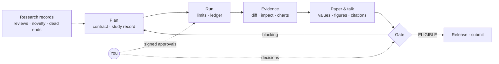

<p align="center">
  
</p>

<h1 align="center">Bio-STEWARD</h1>

<p align="center">
  <b>Scientific Toolkit for Engineering, Workflow Assurance, Reproducibility, and Development</b> <!-- lint: allow (the name) --><br>
  <i>The engineering and integrity layer for agentic computational biology.</i>
</p>

<p align="center">
  
  
  
  
  
  
</p>

<p align="center">
  <a href="docs/index.md">User guide</a> ·
  <a href="docs/quickstart.md">Quick start</a> ·
  <a href="docs/works-with.md">Works with</a> ·
  <a href="docs/principles.md">Principles</a> ·
  <a href="CHANGELOG.md">Changelog</a> ·
  <a href="CONTRIBUTING.md">Contributing</a> ·
  <a href="SECURITY.md">Security</a>
</p>

> **Your agents move fast. Your science stays checkable.** Bio-STEWARD is a small command-line tool (`steward`),
> 24 portable [Agent Skills](https://agentskills.io/), a [GitHub Action](action.yml),
> [pre-commit hooks](.pre-commit-hooks.yaml) and a [Claude Code plugin](plugin/). It keeps a deterministic record of
> what was planned, run, frozen, found and claimed, and refuses the controlled operations (runs, unsealing, spend,
> policy changes) that you did not approve.

<p align="center"></p>

## 🔎 What it catches
| | Failure | How Bio-STEWARD catches it |
|---|---|---|
| 🧪 | **A split that leaks donors, patients or studies** | the benchmark contract fixes splits before results; group, ID and time overlap are checked (R-45, R-49) |
| 🔢 | **A number in the abstract that no longer matches the result file** | every reported number comes from a values registry tied to result files (R-10, R-40) |
| 🧬 | **A re-downloaded GEO series that silently changed** | study records fingerprint inputs and name every paper that cites a stale study (R-75) |
| 🤖 | **LLM test cases that were public before the model's training cutoff** | test cases dated against each model's stated cutoff (possible exposure, not proof of training); a study in tuning *and* test fails; no self-judging (R-78) |
| 📚 | **A citation an AI made up** | each DOI or PMID resolved once and its title recorded; a mismatched title fails (R-77, optional) |
| 🔒 | **A held-out set read too early, a protocol changed after results** | freeze and seal; amendments and unsealing need your signed approval (R-35 – R-39) |
| 💸 | **A paid API loop running overnight** | the spend guard refuses calls past the cap or your signed budget (R-34) |
| 🧭 | **Decisions, reviews and dead ends lost in a chat** | research records: literature reviews, novelty maps, gaps and dead-end reviews, dated and checked (R-76) |

**The principle:** deterministic checks wherever possible; agentic reasoning wherever necessary; human judgment
wherever required.

## 🚀 Quick start
```bash
uv tool install "git+https://github.com/MuizZer07/Bio-STEWARD.git@v0.20.3"     # or: pipx install "git+…@v0.20.3"
cd your-research-repo
steward init --skills .agents/skills         # scaffold; never overwrites. Claude Code: --skills .claude/skills
steward check --summary
```
Then just ask your coding agent: **"Run the using-steward skill."** It runs the checks, reads the result and tells you
what is ready. It is a development tool, never a runtime dependency. Pinning in a requirements file:
`bio-steward @ git+https://github.com/MuizZer07/Bio-STEWARD.git@v0.20.3` (not in package metadata: PyPI refuses
direct references there).

**Try it on real data** (0.20.0): a public GEO series, GSE7621 (Parkinson's disease substantia nigra, 25 samples),
fetched with its checksum, its samples checked, a pre-written analysis run, its tables and paper numbers traced:
```bash
steward example biology my-example && cd my-example && steward check --summary
```

| Break it on purpose | The check says |
|---|---|
| 🧬 a spreadsheet turns a gene symbol into `7-Sep` | ❌ R-83: a gene symbol that looks like a date, row and column |
| 🧪 one sample's `control` becomes `Control` | ❌ R-75: a value not allowed for `condition` |
| 📄 the paper stops naming GSE7621 | ⚠️ R-85: the data-availability statement does not name GSE7621 |
| 🔁 the analysis threshold changes and is re-run | ❌ R-75 results changed · ❌ R-10 the paper's numbers no longer match |
| 💾 one byte of the downloaded matrix changes | ❌ R-75: differs from the sha256 recorded at fetch |

The synthetic [toy benchmark](examples/toy-expression-benchmark/) (contract, prior-work record, LaTeX preprint and
Beamer talk, committed fully built) shows the benchmark and paper kits:
`steward check --final --summary --repo examples/toy-expression-benchmark`.

## 🧩 Two halves: agentic engineering and research
<table>
<tr>
<th width="50%">🤖 Agentic engineering</th>
<th width="50%">🔬 Research and development</th>
</tr>
<tr valign="top">
<td>

- **Runs under limits**: `steward run` stops a whole process tree at memory, time, hang (no CPU progress) or disk
  limits and records the run in a hash-chained ledger.
- **Signed approvals**: spend, unsealing, amendments and policy changes are git tags signed with *your* SSH key;
  an agent can prepare one but never sign it.
- **Spend guard**, **supervised sprints**, **session handoffs**.
- **Dispatch briefs**: `steward task brief TASK --for codex|gemini|claude` turns a task into a self-contained
  prompt for another agent.
- **Many projects, one process**: requests and release notices between repositories, one constitution.
- **Release integrity**: manifests, distribution audits, pinned-dependency retirement.

</td>
<td>

- **Benchmark contracts**: splits, baselines and metrics fixed before results; leakage checked or declared.
- **Study records**: data accessions and fingerprints, genome and annotation releases, database versions, tools,
  and the papers each study feeds.
- **Research records**: literature reviews, novelty maps, gaps and flaws, dead-end reviews.
- **LLM-evaluation hygiene**: contamination by date, studies kept apart, frozen prompts, no self-judging.
- **PaperKit and PresentationKit**: numbers and figures from results; venue rules; talks within what the stage
  supports.
- **Freeze and seal**: protocols, cohorts and held-out data, changed only with your signature.

</td>
</tr>
</table>



## 📏 How it reports
Every check returns one of five statuses; a separate **gate** decides whether you are ready.

| Status | Meaning |
|---|---|
| 🟢 **PASS** | The declared rule held |
| 🔴 **FAIL** | A rule is violated, or an input is malformed |
| 🟡 **INCOMPLETE** | Something required is missing or marked `TBD` |
| ⚪ **UNKNOWN** | It could not be evaluated. It is never counted as a pass. |
| ➖ **NOT_APPLICABLE** | The configuration says the rule does not apply |

The same files always give the same verdict (byte-identical JSON). `--summary` lists every non-PASS result and
nothing else, so agents read less without losing anything; `steward report FILE --rule R-xx` shows one rule's
evidence.

## 🪙 Token cost, measured
Steward is built to be cheap for a coding agent to use, and says what it costs (measured on 0.19.0; a token is about
three quarters of a word):

| What the agent reads | Size |
|---|---|
| Always loaded: the AGENTS block and the core kit's skill descriptions | ~435 words |
| `steward check --quiet` when nothing needs attention | 14 words |
| `steward check --summary` (a new project / the worked example) | 230 / 187 words |
| `steward check` (everything, for a human) | ~840 – 960 words |

Skills load their full text only when a task needs them; `--summary` lists every result that needs action and
nothing else. `steward tokens report` shows what your own sessions cost per task, from your agents' logs.

## 🧰 Kits and skills
| Kit | Skills | For |
|---|---|---|
| **core** | using-steward, task-lifecycle, benchmark-contract, prior-work-grounding, signature-and-attribution, negative-results, run-estimate, no-paid-tests, change-impact, red-team-review, container-release, dependency-upgrade | every project |
| **paper** | paper-kit, number-crosscheck, figures-and-tables, manuscript-drafting, manuscript-review, submission-readiness | manuscripts |
| **talk** | presentation-planning, presentation-building, presentation-review | talks |
| **research** | research-review | literature reviews, novelty, gaps, dead ends |
| **manage** | progress-audit | "Progress Audit" |

Install only the kits you use (`steward init --skills DIR --kits core,research`): agents preload every installed
skill's description, so each kit has a word budget checked in CI. Skills follow the open Agent Skills format and work
with any agent that reads `SKILL.md` or `AGENTS.md`.

## 🤝 Works with, does not replace
Bio-STEWARD is the process layer. It does not run analyses, track experiments, orchestrate workflows or write papers
for you; it downloads public data only through `steward data fetch`, to record where the data came from. Use it alongside **analysis-skill libraries** (they do the science; Bio-STEWARD
checks it), workflow engines (Nextflow, Snakemake), data versioning (DVC, DataLad), experiment trackers and LaTeX,
Quarto or Pandoc. See [docs/works-with.md](docs/works-with.md).

## ⚠️ What the checks do not mean
- A PASS means your files agree with the rules you declared. It does not establish the truth of a result, that a method
  is new, or a benchmark is unbiased.
- **Enforcement covers only what goes through `steward`.** A process that detaches from `steward run`, a paid call
  made directly to a provider, or a commit made with hooks skipped is outside its view. Such bypasses are detected
  later where a record makes that possible, and are stated as limits otherwise.
- **Approvals are only as strong as the trust root and the key.** Pin the trust root outside the repository
  (`steward authorize pin`, or in CI `STEWARD_TRUST_BASELINE` and `STEWARD_TRUST_SIGNERS`); keep approval keys away
  from agents. Step by step: [docs/ci.md](docs/ci.md).
- **A recorded hash names the bytes; it does not keep them.** A study record shows that an input changed; retrieving
  the old one is its retrieval note's job.
- **Leakage checks cover declared identifiers, groups and times**; contamination checks cover declared publication
  dates and the providers' stated cutoffs. Other kinds are *declared* in the contract, recorded and not verified.
- **The MCP server is read-only.** Approvals, runs, spend and anything that writes stay on the CLI.

<details>
<summary><b>📋 Commands</b></summary>

| Command | Purpose |
|---|---|
| `steward init [--paper] [--talk NAME] [--skills DIR --kits …]` | Scaffold the configuration, templates and skills; never overwrites |
| `steward check [AREA…] [--final] [--summary] [--output FILE]` | Evaluate the rules (read-only) |
| `steward report FILE [--format md\|text\|summary] [--rule R-xx]` | Render a saved report |
| `steward run [limits] [--slot] [--input/--output/--metrics] -- CMD` | Controlled execution with a run record |
| `steward diff run A B` / `diff runs [--svg]` / `diff impact` | Repeatability; runs side by side and charted; change impact |
| `steward study new\|list\|show\|fingerprint` | Study records: inputs, references, tools, results, papers |
| `steward research new\|list` | Literature reviews, novelty maps, gaps, dead-end reviews |
| `steward task brief\|template` | Dispatch briefs for Codex, Gemini, Claude or any agent |
| `steward paper values\|displays\|citations\|manifest` | Values registry, display lock, citation record, submission manifest |
| `steward talk plan\|prefs\|values\|export` | Talk planning and export |
| `steward authorize pin\|prepare\|sign\|verify\|pending\|sign-pending` | Signed human approvals, now or later |
| `steward benchmark splits\|results CONTRACT` | Split overlaps; the results matrix |
| `steward freeze` / `amend` / `seal` / `unseal` / `integrity status` | Research integrity |
| `steward spend check\|record\|status` | Spend guard |
| `steward docs init\|build` | A documentation site for your project, with charts and study cards |
| `steward timeline` / `sprint …` / `audit progress` | Deadlines, supervised sprints, the Progress Audit |
| `steward exchange …` / `constitution` | Requests and release notices between projects; the constitution |
| `steward release …` / `pins …` / `storage …` / `hooks …` / `session …` / `mcp` | Releases, pinned dependencies, storage, git hooks, handoffs, the read-only MCP server |

</details>

<details>
<summary><b>📐 Rules (81)</b></summary>

| Area | Rules |
|---|---|
| Configuration and planning | R-01 config · R-02 – R-04 benchmark contract · R-05, R-06 prior-work record · R-07 private-term scan |
| Paper | R-08 spec and venue · R-09 placeholders · R-10 values · R-11 figures and tables · R-12 build log · R-13 venue rules · R-14 citations · R-15 consistency · R-77 citation records (optional) · R-85 data availability |
| Talk | R-21 – R-29: plan, stage, claim ceiling, numbers, limitations, structure, figures, visual checks, wording |
| Runs, approvals, spend | R-31 ledger · R-32 run records · R-33 policy baseline · R-34 spend |
| Research integrity | R-35 – R-39: frozen sets, dataset roles, sealed use, decisions, contract frozen before its first run |
| Benchmark | R-45 splits · R-46 dataset hashes · R-47 results · R-48 comparison provenance · R-49 leakage · R-67 power · R-78 LLM evaluation |
| Studies, data and models | R-75 study records (inputs, conventions, samples) · R-76 research records (advisory) · R-83 table data contracts · R-84 pipeline comparisons (advisory) · R-86 model records |
| Licences | R-79 declared licence · R-80 dependencies · R-81 copied code · R-82 provenance hints (advisory) |
| Evidence and release | R-40 claim map · R-41 prior-work links · R-42 release integrity · R-43 independent review · R-44 runtime fingerprint · R-87 stranger test (advisory) |
| Process and projects | R-50 – R-74: storage, constitution, exchange, sessions, tasks, changelog, branches, skills, agents, stages, frozen sets, containers, dependencies, docs, milestones, sprints, pins |

Every rule: `steward explain R-xx`. The full reference: [docs/reference/rules.md](docs/reference/rules.md).

</details>

<details>
<summary><b>🗺️ Roadmap</b></summary>

| Version | Theme | State |
|---|---|---|
| 0.1 – 0.5 | Process kit, PaperKit, PresentationKit, run safety and approvals, research integrity | Built |
| 0.6 – 0.9 | Evidence and release integrity; benchmarks; storage, MCP and the constitution; exchange between projects | Tagged |
| 0.10 – 0.15 | Hardening; project documentation sites; deferred signing; storage cleanup, milestones, sprints; the Progress Audit | Tagged |
| 0.16 | Public-beta preparation: community files, GitHub Action, pre-commit, plugin, JOSS draft | 0.16.0 tagged |
| 0.17 | Pinned-dependency retirement | 0.17.0 tagged |
| 0.18 | Study and research records, dispatch briefs, charts, LLM-evaluation hygiene, citation records; adopter feedback; the new README and site | 0.18.0 tagged |
| 0.19 | Licence governance, release publishing to a public mirror, install channels, request delivery, token use per task, interactive READMEs, onboarding | 0.19.0 |
| 0.20 | Biology: public data fetched with provenance, data contracts, conventions and sample metadata, data availability, model records, pipeline comparisons, a real GEO worked example | 0.20.0 |
| public beta | Repository public, PyPI, Zenodo, marketplaces (decision D3) | Prepared |
| 1.0 | Stable formats, public release | Designed |

</details>

## 📖 Documentation
- [The user guide](docs/index.md): quick starts, recipes, guides, concepts and the rule reference.
- The worked examples: [a public GEO series, checked end to end](examples/biology-geo/) and
  [the toy benchmark](examples/toy-expression-benchmark/), stage by stage.
- [CONSTITUTION.md](CONSTITUTION.md): one process for the toolkit and every project that adopts it.
- [development/](development/): design documents, decisions and independent reviews; the project uses its own process.

## 🛠️ Development
```bash
pip install -e ".[dev]"
pytest -q
python tools/lint_language.py            # wording rules for the toolkit's own text
python tools/measure_footprint.py --check
tools/ci_local.sh                        # the same checks in Linux containers, on a clean export of HEAD
```

> **Status: pre-release, latest tag `v0.20.3`.** Usable and tested (1600+ tests on macOS; Linux in Docker), not yet
> on PyPI. Configuration and report formats may still change before 1.0. See the [changelog](CHANGELOG.md).

**Licence:** MIT. Contributions are welcome after the public release; until then, issues and ideas are welcome.
