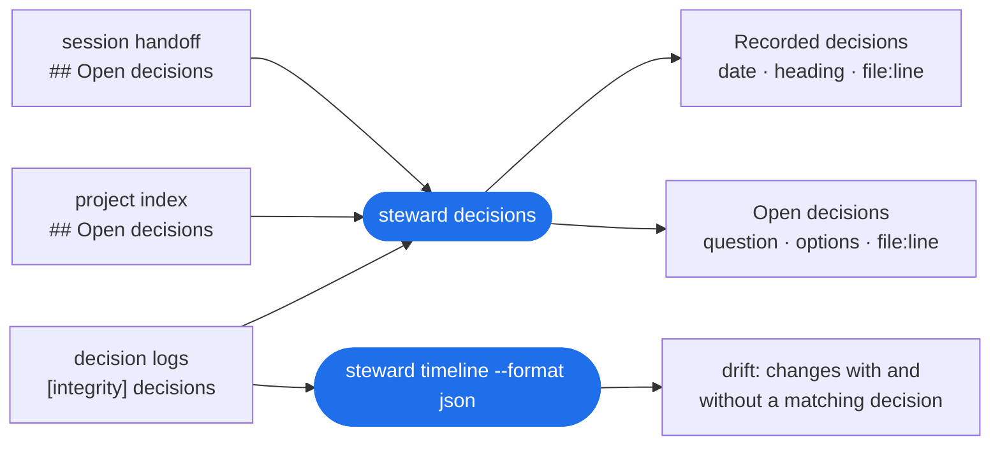

# Read decisions and open questions

`steward decisions` lists what was decided and what is still open, each linked to the file and line it came from.
It reads your records and writes nothing; agents and CI read the same list as JSON.



## Run it

```bash
steward decisions
steward decisions --format json
```

On the toy benchmark example:

```console
$ steward decisions --repo examples/toy-expression-benchmark
Open decisions
- None recorded

Recorded decisions
- 2026-01-15: benchmark design for responder classification (fictional example) (development/DECISIONS.md:12)
```

`--format json` returns `steward.decisions/0.1`: `entries` (newest first) and `open_decisions`.

```json
{
  "entries": [
    {
      "date": "2026-01-15",
      "heading": "2026-01-15: benchmark design for responder classification (fictional example)",
      "title": "benchmark design for responder classification (fictional example)",
      "path": "development/DECISIONS.md",
      "line": 12,
      "quotes": [{"text": "\"Go ahead with the contract and baselines; keep it confirmatory and split by donor.\"", "who": null}],
      "decision": "GO for task `development/tasks/expr-clf-baselines.md`, confirmatory analysis, donor-level splits.",
      "consequences": "model training waits for stage 2; the contract is not changed after results are seen.",
      "body": "…"
    }
  ],
  "open_decisions": [],
  "schema": "steward.decisions/0.1"
}
```

## Where it reads

| Records | What is read |
|---|---|
| The decision logs (the default log, or the paths and globs under `[integrity] decisions`) | Dated headings and speaker bullets that carry their own date; `Quote`, `Decision` and `Consequences` bullets |
| The project index and the session handoff (the living records) | A section headed **Open decisions** |

Design documents are history: a later record settles their questions, so they are not read for open questions.

## Write open questions it can read

Under an **Open decisions** heading, one bullet per question, with its options indented beneath:

```markdown
## Open decisions
- Choose the next review date
  - Keep December
  - Move to January
```

A table works too: a **Decision** or **Question** column, and **Options** or **Recommendation** columns. A **Status**
column can mark a row resolved, and it is then left out. Keep the list current as decisions are recorded:
`steward next` shows the same open questions under "Waiting on you".

## Decisions and drift

`steward timeline --format json` compares the milestones with their history and reports date, scope and order drift,
and whether each change has a matching decision in the logs. See [Plan to a deadline](timeline.md#read-plan-drift).

Recorded decisions are append-only (R-38); see [Single-project governance](single-project.md).
