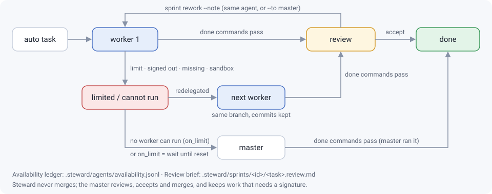

# Delegate to other agents

Each project names one **master** agent and an ordered list of **workers**. The master hands self-contained,
specified subtasks to the workers; steward skips any worker that hits a usage limit, is signed out, is missing, or
cannot start its sandbox, and hands the task to the next worker or back to the master on the same branch. A worker's
passing task enters **review** until the master verifies and accepts it. Nothing merges, signs or publishes by itself.



## 1. Configure the master and workers

Run `steward agents setup` once in the project:

```bash
steward agents setup                       # finds claude, codex and agy; shows the diff; asks before writing
steward agents setup --yes                 # writes without asking (scripts, CI)
steward agents setup --master claude-code  # choose a specific master
```

It writes `[delegation]` (and `[delegation.models]` when a worker has a default model) to `steward.toml`:

```toml
[delegation]
master = "claude-code"                 # reviews, fixes and merges; fallback when no worker can run
workers = ["codex", "antigravity"]     # tried in order
on_limit = "next"                      # "next" | "master" | "wait"

[delegation.models]
antigravity = "gemini-4-neon-high"
```

- **Local only.** Setup looks for `claude`, `codex` and `agy` on `PATH` and in their known install folders (for example
  `~/.gemini/bin/agy`). It reads `--version` and each CLI's local sign-in status subcommand (`claude auth status`,
  `codex login status`) only when `--help` lists it. No prompt is passed, no model is called, and steward opens no
  network connection.
- **AGENTS block.** When `AGENTS.md` carries steward's delimited block (`<!-- >>> steward -->`), `steward agents setup`
  and `steward init` update it to name the project's master and workers so every agent session sees the same roles.
- **Onboarding and checks.** `steward init` offers `steward agents setup` when it finds an installed agent CLI and no
  `[delegation]` table. With `[delegation]` declared, `steward check agents` runs advisory rule **R-89**, reporting any
  configured agent that is not installed.

## 2. Check who can run

```bash
steward agents status                # available, limited until a time, signed out, or missing
steward agents status --format json  # steward.agents_status/0.1
```

Steward learns availability from what actually happened, never from a paid probe. When a worker run ends because of a
usage or rate limit, sign-out, missing executable, or sandbox start failure, steward reads only the end of the log (and
only error events of a JSON-lines log) against one table of endings per agent, extracts any printed reset time (default
one hour when none is printed), and appends the record to the hash-chained local availability ledger
`.steward/agents/availability.jsonl`. Any other exit is a task failure and is not re-delegated.

## 3. When the master delegates, and what it keeps

| Role | Responsibility |
|---|---|
| **Workers** | Self-contained, specified subtasks with clear file scope and checkable acceptance commands (`done` commands or a review brief) |
| **Master** | Reviewing worker output, fixing or asking for rework, running `steward sprint accept`, merging branches, and anything that needs a human signature (spend, policy changes, unsealing, releases) |

Both the `using-steward` and `task-lifecycle` skills carry these rules so the master delegates routinely instead of
doing every subtask itself.

## 4. Delegate a brief or a sprint task

**Headless brief dispatch (`--to auto`):**

```bash
steward task dispatch development/tasks/T-007.md --to auto
```

Steward tries the configured headless workers (`codex`, `antigravity`) in order, skipping any worker currently limited,
signed out or missing. If a run ends in "cannot run", steward records the ending in `.steward/agents/availability.jsonl`
and runs the next worker. When no worker can run, it names the master (and the earliest reset time under
`on_limit = "wait"`) and exits `75`. See [Dispatch a task to another agent](dispatch.md) for brief templates and
`--inline`.

**Supervised sprint tasks (`agent = "auto"`):**

```toml
[[task]]
id = "T1"
title = "Add the contig check"
agent = "auto"                    # first available worker in [delegation]
prompt = "…"
permissions = "edit-and-run"
done = ["python -m pytest -q"]
```

```bash
steward sprint check day1                      # prints the order each auto task will try and who can run now
steward sprint start day1                      # dispatches each ordered task to the first available worker
steward sprint status day1 --format json       # shows review, waiting until, redelegated, and attempts newest first
```

When a worker cannot run, the supervisor records `redelegated` (with the worker, reason and reset time) in both the
sprint ledger and `.steward/agents/availability.jsonl`, then starts the next available worker on the **same branch**,
keeping any earlier commits. A limited worker is skipped until its reset time passes.

| `on_limit` | When a worker cannot run | When no worker can run |
|---|---|---|
| `"next"` (default) | Try the next available worker | The master runs the task |
| `"master"` | The master runs the task at once | The master runs the task |
| `"wait"` | Try the next available worker | Task enters `waiting` until the earliest reset time, shown in `steward sprint status` and `steward next` |

## 5. Review, accept or rework

A worker task whose `done` commands exit 0 ends in **review**, not `done`. Steward writes a review brief at
`.steward/sprints/<sprint>/<task>.review.md` containing the diff summary, commits newest first, each check's exit code
and output tail, any re-delegations, and the deviations sections of any task records the branch changed.

```bash
steward next                                          # lists tasks waiting in review and tasks waiting on a reset
steward sprint accept day1 T1                         # master verified the branch: mark done
steward sprint rework day1 T1 --note "…"              # send back to the last agent with the note in its prompt
steward sprint rework day1 T1 --note "…" --to master  # hand rework to the master
```

A task run by the master ends directly in `done` when its checks pass. Steward never merges branches: merging remains
the master's step under the project's rules. See [Run a supervised sprint](sprint.md) for the full sprint lifecycle.

## 6. Records and token tracking

With `[delegation]` configured, the sprint supervisor records each attempt in `development/agents.jsonl` under task
`<sprint>/<task>` with its agent, provider, model, timestamps and outcome. `steward tokens report` reports each attempt
of the task—including re-delegated ones—with the tokens recorded in that agent's session logs. See
[Track tokens per task](tokens.md).
