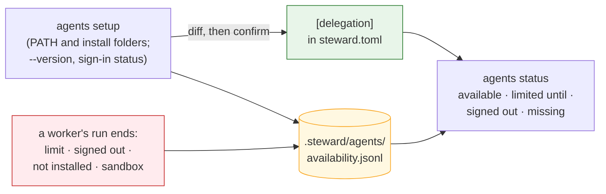
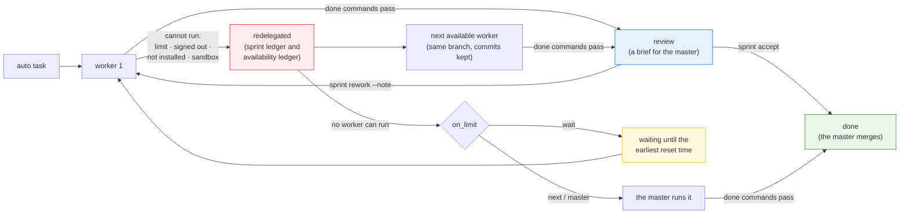

# Dispatch a task to another agent

A review, a re-verification or an implementation can go to another agent: one that did not write the change. `steward
task brief` writes the prompt; `steward task dispatch` also runs it, the way each agent needs when nobody is at the
keyboard, and keeps the report.

```bash
steward task template analysis-review --output development/tasks/AR-001.md  # scripts, notebooks, tables, figures
steward task template review --output development/tasks/T-007.md            # software/release diff review
steward task dispatch development/tasks/T-007.md --to codex           # a read-only review
steward task dispatch development/tasks/T-007.md --to antigravity     # the same, with Gemini in Antigravity
steward task dispatch development/tasks/T-007.md --to antigravity --inline   # when its tools are refused
```

Available brief templates (`steward task template`): `analysis-review`, `review`, `reverification`,
`literature-review`, `novelty-check`, and `figure-check`. In each template, **GO reference** points to the
`development/DECISIONS.md` entry giving the human go-ahead for the task. `steward task brief` warns on stderr if
template placeholders (such as `…`, `ANALYSIS`, `VERSION`, or `DATE`) are still unfilled, and `steward task dispatch`
refuses to run until they are filled in.

The report goes to `.steward/dispatch/DATE-ID-AGENT.md` (or `--output`). Read it, then record it in
`development/assessment/`. `--dry-run` prints what would run.

## What a dispatch takes care of

| Pitfall | What happens without it | What `dispatch` does |
|---|---|---|
| The reviewer reads your working tree | it reviews uncommitted edits, or changes them | a review runs in a clean, detached checkout of the current commit, removed afterwards; a file it changed is reported |
| A sandbox that cannot reach `.git` | in a linked worktree `.git` points back to your repository, outside the agent's sandbox, so `git diff`, `git log` and the tests cannot run | a review's checkout is a local clone in `.steward/dispatch/review-<ID>/` with its own `.git`: every branch and tag, no remote, objects copied (no hard links), no hooks; your repository is not written |
| Codex outside a git repository | `Not inside a trusted directory and --skip-git-repo-check was not specified`; nothing runs | `--skip-git-repo-check`, `-s read-only` (a review) or `-s workspace-write` (`--implement`), stdin closed |
| Antigravity's headless mode | it cannot ask for permission, so it denies every shell command not allowed beforehand, and may print nothing | `--sandbox` and a session-only allow-list of a review's read-only commands (git's reading subcommands such as `git log` and `git diff`, `grep`, `cat`, `python -m pytest`; no `rm`, `cp`, `env`, bare `python` or git as a whole), with the sprint's default deny list |
| A run that still prints nothing | an empty report, read as "no findings" | refused, with the advice to use `--inline` |
| `--dangerously-skip-permissions` | every tool approved for an agent you are not watching | never used |
| Template text left in the task | the agent gets `VERSION` and `…` | refused until the task is filled in |

## `--inline`: no tools at all

With `--inline`, the documents the task names (each `git diff A..B` range in it, and each repository file in
backticks) are put in the prompt, and the agent is told it has no tools and must answer in text only. It works with
any agent and any permission setting; what does not fit (about 200,000 characters) is listed in the prompt, so the
agent says what it could not check. Name the diff and the files in the task's Scope, for example:

```markdown
## Scope
- In: `git diff v1.2.0..HEAD -- src tests`; `CHANGELOG.md`.
```

## Implementing

`--implement` gives the agent a writable checkout of its own (Codex: `-s workspace-write`); nothing is committed,
pushed or merged. Review its changes there, and bring them over yourself.

Other agents (Claude, Gemini CLI, any chat window): `steward task brief TASK --for claude|gemini|generic` and paste
it.

## Delegation: the master, the workers, and who can run now

See [Delegate to other agents](delegation.md) for the end-to-end guide and flow diagram.

One agent is the project's **master**: it reviews, fixes and merges, and takes over when no other agent can run. The
others are **workers**, tried in order. `steward agents setup` writes this for you.

```bash
steward agents setup                 # finds claude, codex and agy; shows the [delegation] it would write; asks
steward agents setup --yes           # writes without asking (a script, CI)
steward agents status                # each agent: available, limited until a time, signed out, missing
steward agents status --format json  # steward.agents_status/0.1
```

```toml
[delegation]
master = "claude-code"                 # reviews, fixes and merges; the fallback when no worker can run
workers = ["codex", "antigravity"]     # in order of preference
on_limit = "next"                      # next worker, then the master | "master" | "wait" (until the reset time)

[delegation.models]
antigravity = "gemini-4-neon-high"
```



| What setup does | What it never does |
|---|---|
| looks for `claude`, `codex` and `agy` on PATH, then in their install folders (`~/.gemini/bin/agy`, `~/.local/bin`, …) | pass a prompt: no model is called |
| reads each one's version (`--version`) and sign-in state from its own status command (`claude auth status`, `codex login status`), only when the agent's `--help` lists it | open a network connection itself |
| proposes `claude-code` as the master when it is installed (or `--master NAME`), the other installed agents as workers, keeping a configured order and models | write `steward.toml` before you confirm (or pass `--yes`) |
| records what it found in the availability ledger | read an agent's account or billing pages |

**Cannot run, or failed?** A worker that hits a usage or rate limit, is not signed in, is not installed, or whose
sandbox does not start, could not do the task at all; that is different from a task that ran and failed. Steward keeps
one table of these endings per agent and reads only the end of a task log (of a JSON-lines log, only its error
events), so a limit message quoted in a file the agent read does not count. A limit's reset time is taken from the
message when the agent prints one (`resets 7:40pm (UTC)`, `try again at 3:04 PM`, `try again in 2 days 3 hours`,
`reset after 2h13m5s`); a limit with no reset time counts for an hour. Each ending is appended to
`.steward/agents/availability.jsonl` (hash-chained, local), and `steward agents status` reads it.

With `[delegation]` declared, `steward check agents` reports a configured agent that is not installed (R-89, advisory:
not in the default gate). `steward init` offers `steward agents setup` when it finds an agent CLI.

## Hand a task to whoever can run it (0.23.0)

With `[delegation]` declared, a task does not have to name its agent. `agent = "auto"` in a sprint task, or
`--to auto` for a dispatch, gives it to the first available worker. A worker that cannot run is skipped, and the task
goes on with the next one, on the same branch.

```bash
steward sprint check day1                      # prints the order an auto task is tried in, and who can run now
steward sprint start day1                      # an auto task goes to the first available worker
steward sprint status day1 [--format json]     # review, waiting until a time, redelegated; each attempt
steward sprint accept day1 T1                  # the master verified a worker's task: it is done
steward sprint rework day1 T1 --note "…"       # back to the same worker; --to master for the master
steward task dispatch T-007.md --to auto       # a headless dispatch: the first available of codex and antigravity
```

```toml
[[task]]
id = "T1"
title = "Add the contig check"
agent = "auto"                    # the first available worker of [delegation] takes it
prompt = "…"
permissions = "edit-and-run"
done = ["python -m pytest -q"]
```



| `on_limit` | when a worker cannot run | when no worker can run |
|---|---|---|
| `"next"` (the default) | the next available worker | the master runs the task |
| `"master"` | the master runs the task at once | the master runs the task |
| `"wait"` | the next available worker | the task waits until the earliest reset time, shown in `sprint status` and `steward next` |

**Who is available.** A worker is skipped while `steward agents status` says it is limited (until its reset time
passes), signed out or missing, and when it cannot offer what the task `requires` (Antigravity's sandbox offers no
network). A worker whose run ended in "cannot run" is not tried again for that task until its next round (a new
order, a rework, or the end of a wait). A run that failed for any other reason is a task failure, as before: it is not
redelegated.

**The master's review.** A task a worker did, whose `done` commands pass, ends in **review**, not done. Steward writes
a review brief next to the task's log (`.steward/sprints/<sprint>/<task>.review.md`): the diff summary and the commits,
each check with the end of its output, and the deviations sections of the task records the branch changed. The master
verifies, fixes on the branch if needed, then runs `steward sprint accept` (done) or `steward sprint rework --note`
(the agent of the last attempt does it again, with the note in its prompt). A task the master ran ends in done, as
before. Nothing is merged by steward: merging stays the master's step. `steward next` lists a task in review under
what waits on you.

**What is recorded.** Each attempt is in the sprint ledger (`running`, then `redelegated`, `review`, `done` or
`failed`, with the agent, its role and, for a re-delegation, the reason and the reset time), and in the agents ledger
(`development/agents.jsonl`) as task `<sprint>/<task>` with its agent, provider, model and outcome. `steward tokens
report` then shows each attempt of the task, re-delegated ones too, with the tokens its agent's logs recorded in it.
Without `[delegation]` a task ends in done as before.

**A task that names its agent.** It runs with that agent. With `[delegation]` declared, when the named agent is a
worker (`agent = "codex"` or `agent = "antigravity"`) and its run ends in "cannot run", the task moves as an auto task
does: to the next available worker of `workers`, then as `on_limit` says. The ledger's `redelegated` entry and the
next `running` entry carry `moved_from` (the named agent), `sprint status` lists both attempts, and the report's agent
column reads `codex (antigravity)`. After a wait, the named agent is asked for first once it is available again; a new
`go` order starts with the named agent again. A task that names the master, and any task without `[delegation]`,
fails as before when its agent cannot run.

| The task's `agent` | with `[delegation]`, its agent cannot run | without `[delegation]` |
|---|---|---|
| `"auto"` | the next available worker, then `on_limit` | the task fails: `auto` needs `[delegation]` |
| a worker (`"codex"`, `"antigravity"`) | the next available worker, then `on_limit` (0.23.0, D02b) | the task fails, as before |
| the master | the task fails, as before | the task fails, as before |

**Codex's partial work is committed.** Codex's sandbox cannot write `.git`, so the sprint commits its changes after
it exits. A Codex run that ends in "cannot run" (a usage limit, for example) is committed too, with a message that
says so (`…; the run was stopped by a limit (usage limit, resets …); partial work`), so the next agent starts from
committed work and a retry finds it on the branch. A Codex run that fails for any other reason is not committed: its
changes stay in the worktree, as before.

**`--to auto` for a dispatch.** The workers with a headless dispatch (Codex, Antigravity) are tried in order; a run
that ends in "cannot run" is recorded in the availability ledger and the next one runs. When none can, the command
names the master (and the earliest reset time with `on_limit = "wait"`) and exits 75.
