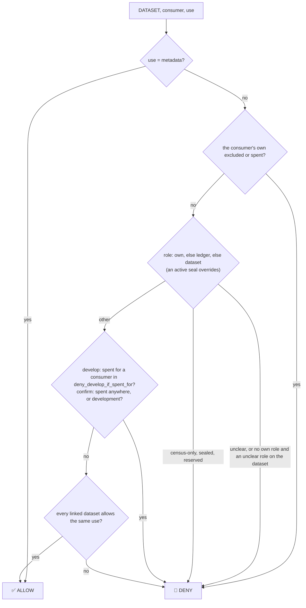

# Freeze, seal and approve

| Need | Command | Rule |
|---|---|---|
| Fix a confirmatory design before results | `steward freeze design --files … --contract …` | R-35, R-39 |
| Keep held-out data unused | `steward seal DATASET`; unsealing needs a signed approval | R-36, R-37 |
| Know who may use a dataset for what | `steward integrity access DATASET --consumer STUDY --use develop\|confirm\|metadata` | R-36 |
| Run outcome stages only after a GO | `[[stages]]` and `steward stage run NAME -- CMD` | R-68 |
| Approve spend, amendments, unsealing, waivers | `steward authorize prepare …`, then **you** run `steward authorize sign` | R-33, R-34, R-38 |

Approvals are signed git tags verified against a trust root pinned outside the repository
(`steward authorize pin`). An agent prepares them; only a human signs. Setup: [CI and the approval key](../ci.md).

## Who may use a dataset

`development/datasets.toml` gives each dataset a role, and may give each study or paper (a *consumer*) a role of its
own. `steward integrity access DATASET --consumer STUDY --use develop|confirm|metadata` prints `ALLOW` or `DENY` with
the reason, and exits 0 or 1.

```toml
schema = "steward.datasets/0.1"

[datasets.series-b]
role = "development"
identifier = "accession:geo:GSE12345"      # also doi:, pmid:, arxiv:, url:, local:<id>
links = ["report-a"]                       # access also needs report-a to allow the same use
consumers = { study1 = "development", study2 = { spent = true }, study3 = { excluded = true } }

[datasets.report-a]
role = "unclear"
identifier = "local:report-a"

[consumers.study4]
deny_develop_if_spent_for = ["*"]          # or a list of consumers
```

| Setting | develop | confirm | Who it affects |
|---|---|---|---|
| role `development` | allowed | denied | everyone without a role of their own |
| role `spent` (dataset-wide, or a consumer's plain `"spent"`) | allowed | denied | confirm is denied for **everyone** |
| role `sealed` | denied | denied | everyone, until a signed unseal |
| role `reserved` | denied | denied | that consumer, or everyone without a role |
| role `census-only` | denied | denied | metadata only |
| role `unclear` (on the dataset or on any consumer) | denied | denied | consumers without a role of their own, and the consumer whose role is `unclear` |
| `{ spent = true }` for a consumer | denied | denied | that consumer; confirm is also denied for everyone, as for any spent data |
| `{ excluded = true }` for a consumer | denied | denied | that consumer only |
| `[consumers.X] deny_develop_if_spent_for` | denied | – | consumer X, on data spent for a listed consumer (`"*"`: any) |
| `links = [...]` | as the strictest link | as the strictest link | everyone; links are followed through chains, and a cycle ends |

The answer is worked out in this order; the first DENY wins:



`metadata` is always allowed. The table form takes `role` too: `study1 = { role = "development" }` is the same as
`study1 = "development"`. A plain `"spent"` keeps its earlier meaning (that consumer may still develop on the data);
use `{ spent = true }` to close the consumer's own use. R-36 fails a link to a dataset that is not declared.
