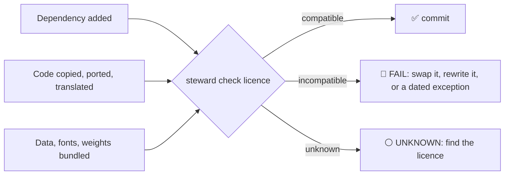
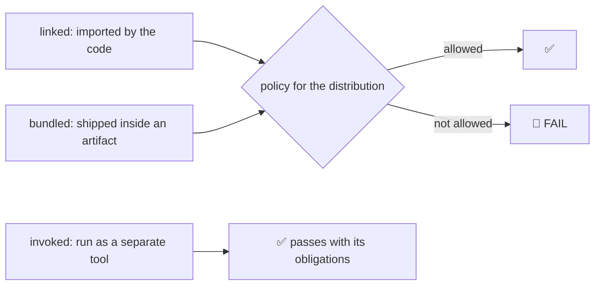

# Govern licences from the first commit

A licence conflict found at release blocks a release that is already tagged. Found on the commit that brings it in,
it costs a package swap. Bio-STEWARD checks three ways a conflict enters a project, at the strictness its
distribution calls for.



## Declare
```toml
[licence]
declared = "MIT"                 # SPDX expression, as in LICENSE and the package metadata (R-79)
distribution = "internal"        # internal | network | public: stricter to the right
policy = "weak-copyleft-ok"      # permissive-only | weak-copyleft-ok | gpl-compatible
lockfile = "uv.lock"             # or poetry.lock, requirements.txt; else every installed package
site_packages = [".venv/lib/python3*/site-packages"]   # the project's environment
deny = ["AGPL-3.0*", "SSPL-*"]
exceptions = "development/licence-exceptions.toml"
third_party = "development/third-party.toml"
use = { "some-cli-tool" = "invoked" }   # linked (the default) | bundled | invoked, per package (0.22.0)
```

## Use and distribution are separate facts
How the project **uses** a dependency and how the project is **distributed** are declared apart, and the check reads
both.



| `use` | What it means | How R-80 judges a copyleft package |
|---|---|---|
| `linked` (default) | imported or linked into the project's code | by the policy for the distribution state, as in the table below |
| `bundled` | shipped inside an artifact (an image, an archive, a wheel) | the same as `linked`; the report names the declared use |
| `invoked` | only run as a separate program (a command-line tool, a build tool) | not a FAIL: it passes with its obligations stated |

- A package not named in `use` is `linked`, so a project without `use` is checked as before.
- Names compare as installers compare them (`Some_Tool` and `some-tool` are one package); two spellings of one
  package in `use` are refused.
- The deny list wins for every use, and an unknown licence stays UNKNOWN whatever the use.
- A `use` name that matches no package in the inventory is noted (`R-80.use_unmatched`); it is not a failure.
- `steward licence inventory --json` gives a `use` field for each package named in `use`.

**Distribution** stays the `distribution` setting (internal, network or public, since 0.19.0), and **which licences a
project rejects** stays its own policy: the `policy` profile plus the `allow` and `deny` lists. Whether a project that
pins this one ships it onward is that project's decision, made in its own `[licence]`.

## What is checked
| Rule | Checks |
|---|---|
| R-79 | LICENSE, pyproject.toml, package.json, DESCRIPTION and CITATION.cff state the declared licence |
| R-80 | every dependency's licence (License-Expression, classifiers, the licence field) against the policy; unknown is UNKNOWN, never a pass; weak copyleft passes with its obligation where the policy allows; a public project's third-party notices name every dependency; a lockfile change names what it added or upgraded |
| R-81 | items in `third_party` and files whose `SPDX-License-Identifier:` or `Derived-from:` header names another licence |
| R-82 | advisory: comments such as "ported from" or "adapted from" in files with no declaration |

| Licence family | internal | network | public |
|---|---|---|---|
| permissive (MIT, BSD, Apache-2.0, …) | ✅ | ✅ | ✅ |
| weak copyleft (LGPL, MPL, EPL) | ✅ + obligation | ✅ + obligation | by policy |
| strong copyleft (GPL) | ✅ + obligation | ✅ + obligation | only `gpl-compatible` |
| network copyleft (AGPL, SSPL) | ✅ + obligation | 🔴 | 🔴 |

## Copied and ported code
A translation into another language is still a derivative work. Declare it:
```toml
schema = "steward.third-party/1"
[[item]]
path = "src/pkg/smooth.py"
licence = "GPL-2.0-or-later"
source = "R, src/library/stats/src/lowess.c"
kind = "ported"
```
or put headers in the file: `# SPDX-License-Identifier: …` and `# Derived-from: PROJECT FILE (LICENCE)`.

## Exceptions
```toml
schema = "steward.licence-exceptions/1"
[[exception]]
target = "somepackage"           # a package name or a path glob
licence = "GPL-3.0-only"
reason = "replaced in 2.0"
scope = "project"
approver = "the maintainer"
date = 2026-11-25
expires = 2027-01-31             # an expired exception fails
```

## Going public
Set `distribution = "public"`: every check re-runs at the stricter level, and the notices must be current:
```bash
steward licence notices --write              # THIRD_PARTY_NOTICES.md
steward licence notices --format cyclonedx   # an SBOM
```
A release manifest records the licence inventory and is refused while a licence check is FAIL or UNKNOWN; release
notices carry a licence summary for the projects that use the release.

These checks cover declared rules and package metadata. They are not legal advice.
