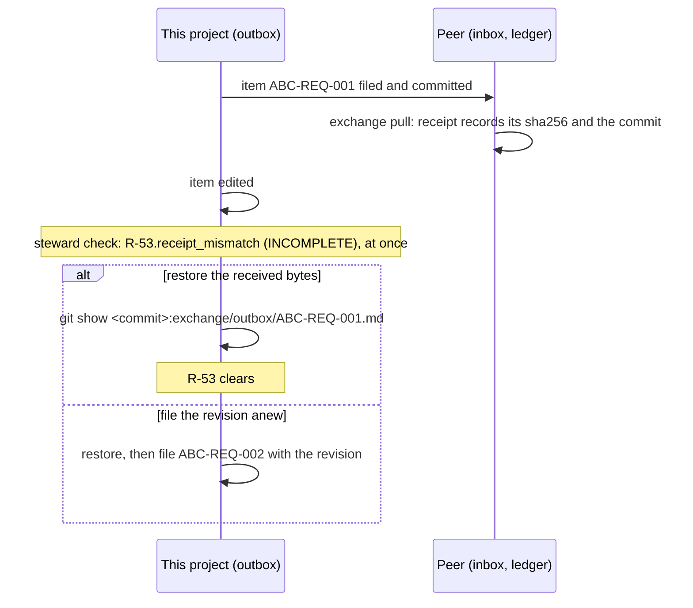
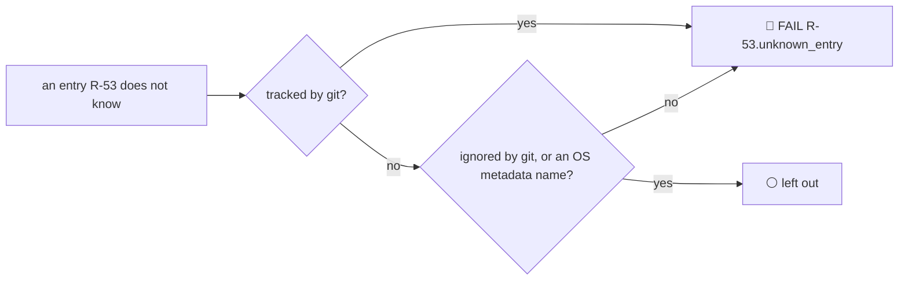
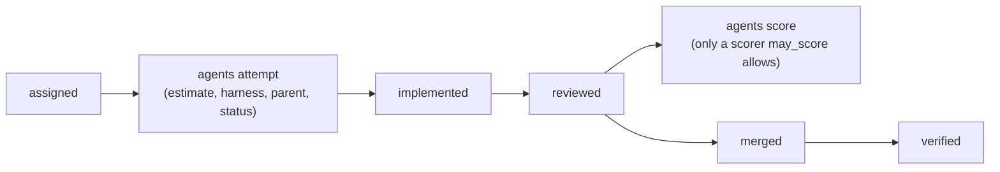

# Multi-project governance

For a lab or team running several projects and agents. Each project keeps its own repository; they share one
process.

- **One constitution** (`steward constitution`): the same rules on authority, records, change, review, releases,
  continuity and privacy in every project (R-51).
- **Requests between projects** (`exchange/`): items with IDs, a state machine and an append-only ledger. A project
  files a request in its outbox; the other `steward exchange pull`s it from the committed revision, `respond`s, and
  the requester sees the decision as an observation. Projects without Bio-STEWARD get a one-way item to export
  (R-53, R-54).
  - **Your own term lists first:** `receive` and `pull` check an incoming item against this project's R-07 term
    lists and local-path check, for the path it would have in `inbox/` (and, for your own item imported from the
    peer's inbox, at its `outbox/` path). On a hit, nothing is written for that item and the lines are named, never a
    private list's term (an ID that matches one is withheld too). An item holding a NUL byte is refused: R-07 would
    skip it as binary. Ask the sender to re-file it in generic words, or take it anyway with `--allow-terms`
    (recorded in its receipt).
  - **Superseded or withdrawn:** a received request, defect, feedback or question still open can be closed as
    `steward exchange state ID superseded --by NEW-ID` (another item received from the same sender) or
    `withdrawn --note WHY` (also through `respond`). Release notices and received responses cannot. When its receipt
    holds the file's hash (items received since 0.9.0), the command says the file may go: remove it with `git rm`;
    the ledger keeps the receipt and R-53 accepts the gap, and the sender's copy is never received again. Close it
    later with `state ID closed`.
  - **What the other side reported:** `steward exchange status` shows, for each of your own items, the furthest
    state the receiver reported (shipped beats a later accepted) and the latest one when it differs.
- **Release notices:** a library `announce`s each release to its declared consumers, who acknowledge, then adopt
  (after their parity check) or decline.
- **Agent attribution:** `steward agents attempt|score|event` records which model did what, and no attempt is scored
  by its author (R-62). `steward agents list` shows it per task. See [The agents ledger](#the-agents-ledger).
- **Shared run slots:** `[run] slots_dir` lets several checkouts share one limit on heavy jobs.

## Exchange delivery

Set a peer's ref once in `steward.toml`. Use its shared branch for exchange records, so pulls can find committed
items while the peer's checkout is on a feature branch.

```toml
[exchange]
code = "ABC"
peers = { DEF = { path = "../peer", ref = "dev" } }
delivery_days = 14
```

A short ref such as `dev` names a branch. A full ref such as `refs/remotes/origin/dev` names a locally available
ref. A peer can also use `url = "https://git.example.org/team/peer.git"` with a ref. URL checks fetch the ref
into a temporary repository. A plain path such as `DEF = "../peer"` still reads the checkout's committed `HEAD`.

Steward also reads the machine's project registry. It looks at the committed `HEAD` of registered checkouts that
declare `[exchange]` and name this project as a peer or send it an item. It also checks registered recipients for
receipts. Declare the path and ref if multiple registered checkouts use the same code.
Set `STEWARD_NO_REGISTRY=1` to use declared peers only.

`steward session start` and `steward exchange status` show which items are waiting in each direction. Use
`steward exchange pull [PEER]` to receive them and commit the new inbox files and ledger so the sender can see
the receipts. Steward checks the receiver's ledger chain and compares the receipt hash with the item's bytes.
Older acknowledgements recorded before receipt hashes still count. If a ledger cannot be read or its chain has
a break, status marks the delivery as unchecked.

R-53 reports an advisory when an outbox item is older than `delivery_days` and has no matching receipt. The
default is 14 days. Check the receiver's ref and ask the receiver to pull and commit its receipt.

**An item edited after the peer received it** (0.22.0): when one of your outbox items differs from the bytes the
peer's committed receipt records, R-53 is INCOMPLETE at once with `R-53.receipt_mismatch`, whatever the item's age
and before any response arrives. The message names both sha256 hashes and the commit the peer received. There are
two ways out:



- restore the received bytes (`git show <commit>:exchange/outbox/<ID>.md > exchange/outbox/<ID>.md`), which clears
  it;
- or restore them and file the revision as a new item with a new ID.

## Files that are not part of the exchange

R-53 checks the fixed layout of `exchange/`: an unknown entry is a FAIL (`R-53.unknown_entry`). Since 0.22.0 it
leaves out an entry that is **untracked** and either

- ignored by git (one `git check-ignore`, run with the same safe git settings as every other git call), or
- an OS metadata file: `.DS_Store`, `Thumbs.db`, `desktop.ini` (any case) or an AppleDouble `._*` file.



A file manager that writes `.DS_Store` into `exchange/` no longer blocks the gate or the pre-commit hook. A tracked
unknown file, or an unknown file that is neither ignored nor an OS metadata file, still FAILs. A tracked `._ID.md`
file is read as an item, as before. Outside a git repository nothing is tracked or ignored, so only the OS metadata
names are left out.

## The agents ledger

`[agents]` in `steward.toml` turns on an append-only ledger (`development/agents.jsonl`) of who attempted each task
and who scored it. Since 0.22.0 it can also say **who may score whom**, and hold what a performance ledger needs.

```toml
[agents]
# scorer = [the authors whose attempts it may score]
may_score = { final = ["impl"] }   # the final reviewer scores implementers; never the reverse
```

| Setting | Who may score an attempt by `impl` | Who may score an attempt by `final` |
|---|---|---|
| no `may_score` (as before 0.22.0) | any agent but `impl` | any agent but `final` |
| `may_score = { final = ["impl"] }` | `final` | no one |
| `may_score = {}` | no one | no one |

The author never scores its own attempt, whatever the table says. `steward agents score` refuses a score outside
the table (exit 64) and writes nothing; R-62 FAILs a hand-written one (`R-62.not_permitted`). An override
(`--override REASON`) is checked against the table too.

**What an attempt can record.** Each option is optional; an attempt without them is recorded exactly as before.

| Option | Recorded as |
|---|---|
| `--estimate-file FILE` | `estimate`: the JSON object in FILE (assumptions, effort, cost, tokens: any fields) |
| `--harness`, `--harness-version` | the harness that ran the agent, beside `--provider` and `--model` |
| `--suggested` | the model suggested for the task (as before), next to the one used |
| `--parent TASK` | the parent task |
| `--status` | the task's status at this attempt |

**Milestones.** `steward agents event TASK --kind KIND --time T` records when a task was `assigned`, `implemented`,
`reviewed`, `merged` or `verified`. T is an ISO 8601 time with a time zone (`2026-11-27T10:00:00Z`). Record each
reassignment as another `assigned` event, or as a new attempt by the new agent.



```bash
steward agents attempt T-7 --agent impl --provider p --model m --estimate-file estimate.json --harness h --harness-version 1.2
steward agents event T-7 --kind implemented --time 2026-11-27T11:00:00Z
steward agents score T-7 --attempt 1 --scorer final --score 4 --rubric review-v1
steward agents list
```

`steward agents list [TASK]` prints each task with its attempts (their estimates and scores) and events. Every list
is newest first: tasks by their newest record, attempts by number, scores by when they were recorded, events by
their time. `--format json` writes the same as a `steward.agents_list/0.1` document, in the same order; a field an
attempt did not record is `null`. `steward tokens report` reads attempts as before; events and the new fields do not
change its windows.

## Report a toolkit defect

`steward issue "…"` or `steward issue --from-last-error` files a screened defect item in `exchange/outbox/`,
addressed to `STW` (or `[report] to`); the toolkit side groups what it receives with `steward issues inbox`. Filing
needs no network. See [Report a toolkit defect](report-a-defect.md).
