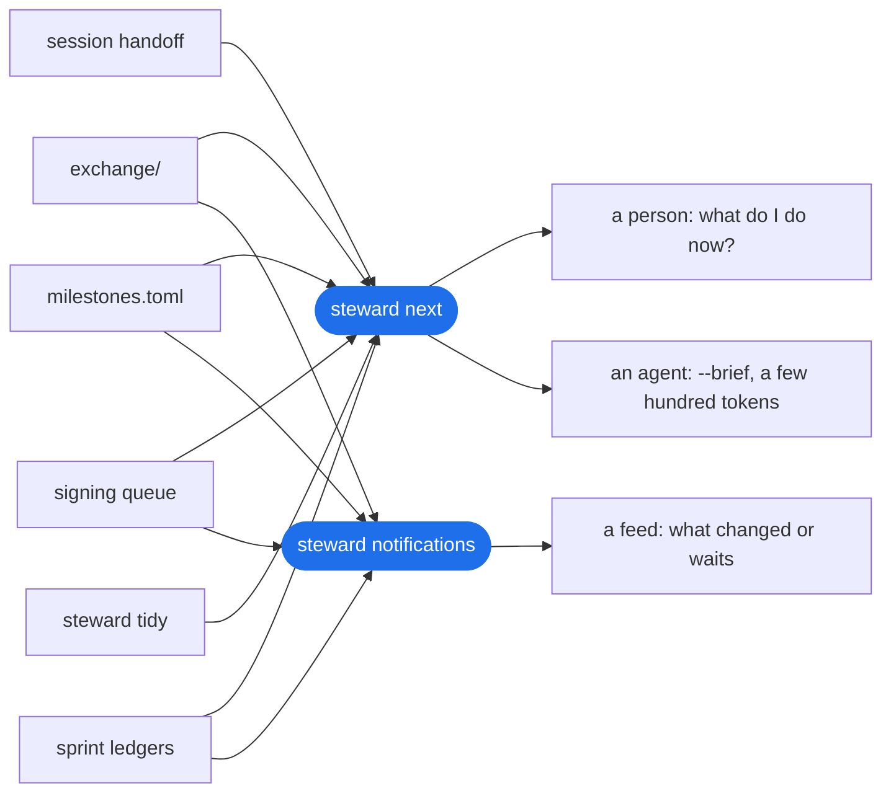

# Where you are, what is next, what is stale

Three read-only commands answer the questions a person or an agent asks at the start of a session. Every line comes
from the project's own records (git, the ledgers, the exchange folder, the signing queue), never from a guess, and
none of them opens a network connection.



| Command | Answers | JSON |
|---|---|---|
| `steward next` | Where did I leave off, what is due, what waits on me, what are the agents doing, what has gone stale? | `steward.next/0.1` |
| `steward tidy` | Which tasks, pages, exchange items, branches and memory entries look stale? | `steward.tidy/0.1` |
| `steward notifications` | What changed or waits: a newer CLI, new exchange items, sprint tasks, approvals, gates, milestones? | `steward.notifications/0.1` |

## `steward next`

```console
$ steward next
Where you left off: development/HANDOFF.md (3 days old)
  1. Run the baseline under the frozen contract
  2. Draft the methods
Next milestone: preprint "Preprint" · 6 days · AT RISK
  blocking: task PRJ-001, signature spend
Waiting on you (2)
  signature    spend (scope task=PRJ-001, expires 2026-12-31T00:00:00Z)
               -> steward authorize sign-pending
  decision     P4: drop cohort C?
               -> steward session start
Waiting on agents (0): nothing
Needs tidying (2): 1 stale task, 1 stale page -> steward tidy
```

- **Where you left off** is the "Next" list of the session handoff (`steward session close` writes it).
- **Next milestone** is the soonest milestone without an outcome, with what blocks it: the gate's blocking rules,
  open tasks, exchange items and signatures that wait (the same reading as `steward timeline`).
- **Waiting on you:** signatures in the queue, the open decisions the handoff lists, received exchange items with no
  decision yet, sprint tasks waiting for your order, failed sprint tasks, and done tasks whose branch is not merged.
- **Waiting on agents:** sprint tasks running, checking, or ordered and not yet started.
- **Needs tidying:** the counts of `steward tidy`.

`steward next --brief` prints the same, shorter, for an agent starting a session. `steward next --format json` holds
every field, each item with its source record and one command. `--now 2026-12-01T09:00:00Z` evaluates at another
time, so a state (a milestone at risk) can be reproduced; `steward timeline --now` does the same.

## `steward tidy`

| Finding | How it is decided |
|---|---|
| Stale task | an open board task whose file, runs and sprint events have not moved for `stale_days` |
| Contradiction | the board says open while a sprint ledger says done; an own exchange item still open after its response arrived |
| Stale page | the handoff is older than `handoff_days`; the handoff or the index names no version as recent as the latest tag |
| Exchange | received and not acknowledged in time; not received by the peer in time; in a local peer's outbox, not received here |
| Leftover | a sprint branch merged into the main branch, and its worktree |
| Memory | in each folder of `[tidy] memory`: entries not changed for `memory_days`, entries naming paths that no longer exist here, duplicates |

Nothing is changed. Thresholds are per project:

```toml
[tidy]
stale_days = 14       # an open task untouched for longer is stale
handoff_days = 7      # a handoff committed longer ago is stale
memory_days = 30      # a memory entry not changed for longer is listed
memory = ["~/.claude/projects/my-project/memory"]   # a harness's folders for this project (read, never changed)
index = "development/INDEX.md"
archive = "development/archive"
```

With `[tidy]` declared, R-88 (advisory: no gate requires it unless you name it) reports the same counts in
`steward check`, except memory and what only a peer's checkout shows (items not delivered are R-53's), which are
outside the repository.

**Nothing is archived or deleted unasked.** The owner decides, for each project, whether a stale task is archived,
deleted or kept. `steward tidy --archive PRJ-001` moves that task file into the archive folder as one change ready to
commit (with `git mv` when the file is tracked); add the folder to `[tasks] archive`. An ID named twice, or two
task files that would land on the same name in the archive folder, is refused before anything moves (exit 65).
Memory belongs to the harness:
the owner, or the agent on the owner's word, cleans it there. The `task-lifecycle` and `progress-audit` skills tell
agents to name the stale items for each project and ask before acting.

## `steward notifications`

```console
$ steward notifications --format json
```

Each item has an `id` (stable while its cause lasts, so a reader can remember what it has read), a `time`, a `kind`,
its `source` record, a `title`, its next `command`, and `urgent`:

| Kind | When | Urgent |
|---|---|---|
| `upgrade` | a received Bio-STEWARD release notice names a version newer than this CLI (the same test as `steward upgrade --check`, prereleases included) | no |
| `exchange` | a received item has no decision yet | no |
| `task_finished`, `task_failed` | a sprint task ended in the last `--days` days (default 14) | failed: yes |
| `task_waiting` | a sprint task is ready and waits for its order | no |
| `approval` | a prepared authorization waits for its signature | yes |
| `gate` | a gate eligible in the report given with `--against` is not eligible now (this runs a check) | yes |
| `milestone` | a milestone is at risk or late | no |

The feed decides nothing for you and keeps no state: which items you have read is the reader's to keep.

`--against` takes a report written by `steward check --format json`. A file that is not such a report (no
`verdict` object, or `gates` that is not a list) exits 65; with `--format json`, stdout holds a `steward.error/0.1`
document with the code `invalid_input`.
