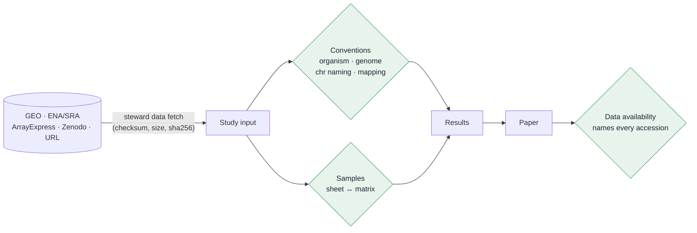
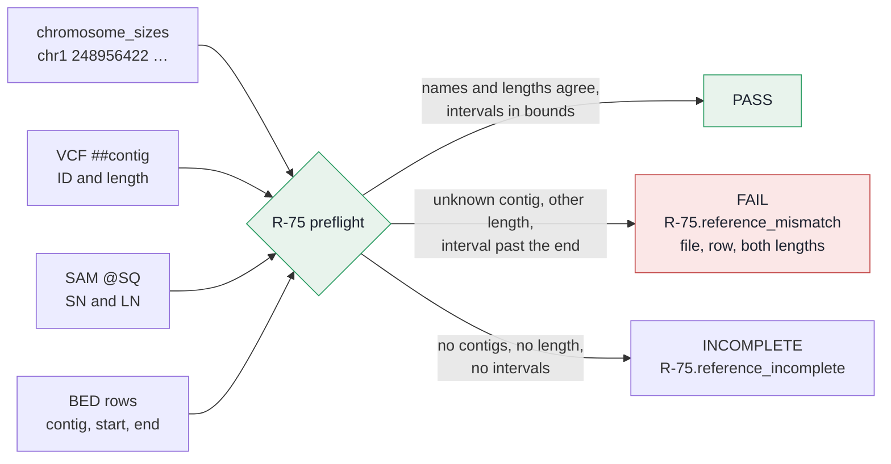
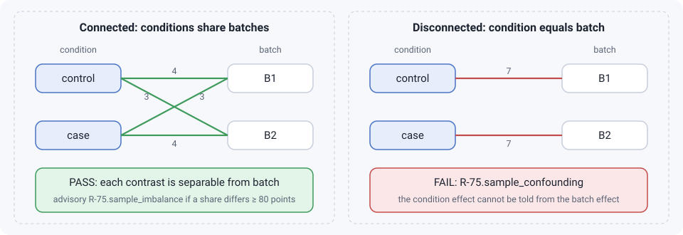

# Work with public data: fetch, conventions, samples, data availability

Bio-STEWARD checks the identity of recorded files, the study's biological conventions, the sample design, and the
tables and data-availability statements that report the results. These checks run offline with `steward check`.



| Check | Where it is declared | Rule |
|---|---|---|
| VCF and SAM header contigs and BED intervals fit the declared genome | the study's `[references]` | R-75 |
| Scoped text contains no recognized controlled-access accessions | `[privacy]` or `[[terms]]` | R-07 |
| A Bioconductor tool entry records a major.minor release | the study's `[[tools]]` | R-75 |
| Local result tables follow their identifier and statistics declarations | [Data contracts](data-contracts.md) | R-83 |
| Conditions overlap across batches and each declared categorical covariate | the study's `[samples]` | R-75 |
| The file is the one fetched (sha256, size, the archive's md5) | `[[inputs]]` of a study, written by `steward data fetch` | R-75 |
| An input declares the same organism, taxon, genome, coordinate base and chromosome naming as its study | `[references]` and `[inputs.references]` | R-75 |
| A BED, GTF, GFF or VCF file names its chromosomes the way the study says (`chr1`, `1` or `NC_000001.11`) | `chromosome_naming` | R-75 |
| The identifier mapping table is the version recorded | `[references] mapping` | R-75 |
| Every sample has the required fields and allowed values; matrix columns and sheet rows match | `[samples]` | R-75 |
| The paper's data-availability statement names every accession of the studies that cite it | the paper's `spec.toml` | R-85 |

## Check contigs against a genome (B03)

Declare the genome and the path to its chromosome-sizes file in the study record.
Use the same local file in each study that uses that genome and contig naming.

```toml
[references]
genome = "GRCh38"
chromosome_sizes = "data/GRCh38.chrom.sizes"
```



The sizes file is plain text with one case-sensitive contig name and positive length
per line, separated by whitespace. Blank lines and comment lines starting with
`#` are allowed. For example, a line for human chromosome 1 is `chr1 248956422`.

Run `steward check studies` in the terminal or CI. Use
`steward check studies --format json` for the tagged report. R-75 checks each
recorded VCF, SAM and BED input, including gzip and BGZF text. It compares VCF
`##contig` IDs and lengths and SAM `@SQ` names and lengths with the sizes file.
For BED, each contig must exist and each interval must satisfy
`0 <= start <= end <= contig length`. The sizes file supplies the exact names
for these inputs when the preflight is enabled. Existing study records can omit
`chromosome_sizes`.

A mismatch fails with the file and row, and a length mismatch shows both
lengths. A header without contigs, a VCF contig without a length, or a BED
without intervals gives an incomplete result. VCF and SAM checks stop at the
end of the header. The preflight checks BED rows through the end of the file.
The preflight reads local files and reports a finding if a line exceeds 1 MiB,
the sizes file exceeds 8 MiB, or an input scan exceeds 256 MiB of raw or
decompressed text. The study's SHA-256 checks still stream all fingerprinted
files in chunks.

## Fetch with provenance (`steward data fetch`)

```bash
steward data fetch GEO:GSE7621 --study pd-substantia-nigra             # the series matrix
steward data fetch GEO:GSE7621 --file GSE7621_RAW.tar --study …         # a supplementary file
steward data fetch ENA:SRR1234567 --study …                             # every FASTQ of a run (SRA: works too)
steward data fetch ArrayExpress:E-MTAB-1234 --file samples.sdrf.txt --study …
steward data fetch Zenodo:1234567 --study …                             # every file of a record (--file to pick)
steward data fetch https://example.org/table.tsv --sha256 HEX --study …  # a plain URL, with the checksum you were given
steward data fetch GEO:GSE7621 --study … --dry-run                      # where each file comes from and goes
```

Files go to `data/raw/ACCESSION/` (or `--dest`, inside the repository and never through a link). A broken download
resumes from its `.NAME.part` file. When the archive publishes a checksum (ENA and Zenodo give md5) or a size, the
file must match it; with `--sha256`, so must the sha256. A mismatch removes the partial file and records nothing.
On success the study gets one `[[inputs]]` table:

```toml
[[inputs]]
id = "GSE7621"
source = "GEO"
accession = "GSE7621"
retrieved = 2026-11-25
files = [{ path = "data/raw/GSE7621/GSE7621_series_matrix.txt.gz", sha256 = "1389f0dc…", size = 3450662,
           url = "https://ftp.ncbi.nlm.nih.gov/geo/series/GSE7nnn/GSE7621/matrix/GSE7621_series_matrix.txt.gz" }]
```

This is the only command here that uses the network. Checks read the recorded files and never fetch.

## Conventions that break reanalyses (B3)

```toml
[references]
genome = "GRCh38"
annotation = "GENCODE 44"
id_namespace = "Ensembl gene"
organism = "Homo sapiens"
taxon = 9606
coordinate_base = 0                # 0 (BED, half-open) or 1 (GTF, VCF, SAM)
chromosome_naming = "ucsc"         # ucsc (chr1) | ensembl (1) | refseq (NC_000001.11)
mapping = { path = "data/probe-to-gene.tsv", version = "GPL570 annotation, NCBI GEO, 2016-08-09" }

[[inputs]]
id = "peaks"
files = [{ path = "data/peaks.bed" }]
[inputs.references]                # what this input's source declares, when it is not the study's
genome = "GRCh37"                  # FAIL R-75.convention_mismatch: lift it over first, or record why not
```

The mapping table is fingerprinted like an input (`steward study fingerprint ID --write`). Across studies,
`[studies] consistent = ["genome", "organism", "chromosome_naming"]` reports studies that disagree.

## Sample metadata (B4)

```toml
[samples]
path = "data/samples.tsv"
id_column = "sample"
required = ["organism", "tissue", "condition", "batch"]   # the default; list the fields your design needs
allowed = { condition = ["control", "case"], sex = ["female", "male"] }
matrix = [{ path = "data/raw/GSE7621/GSE7621_series_matrix.txt.gz" }]   # skip_columns = 1; subset = true
```

Each finding names the file and row: a required field that is absent or empty (`NA`, `unknown`, `-` and similar
count as empty), a value outside `allowed` (`Case` is not `case`), a duplicate sample ID, a matrix column with no
row in the sheet, and a sheet row that is not a column of the matrix (unless `subset = true`). A GEO series matrix
is read after its `!series_matrix_table_begin` line. The matrix must also be a recorded input of the study.

R-75 cross-tabulates `condition` by `batch` when both columns are present. To use
different names, declare `condition_column` and `batch_column` under `[samples]`.
Declare additional categorical factors with `covariates = ["sex", "site"]`.
Explicitly named design columns require values for every sample.



Complete confounding fails. For each factor, the observed combinations must connect
all condition levels through shared factor levels. Separate groups of levels leave
some condition contrasts inseparable from that factor in an additive design.
In a connected design, the check emits an advisory when a condition's share differs
by at least 80 percentage points between any two levels of a factor. Findings
include the relevant cross-table counts. The check compares each factor individually.

## Analysis environments

Place `renv.lock` or `conda-lock.yml` at the repository root to capture its
SHA-256 in the environment metadata from `steward run`. You can also list a
lockfile among a study's recorded inputs to track changes with R-75. Record the
Bioconductor release separately from individual R packages.

```toml
[[tools]]
name = "Bioconductor"
version = "3.21"
```

## Controlled-access accessions

With privacy checks configured, R-07 flags accession forms such as dbGaP
`phs…` and EGA `EGAD…` or `EGAS…` in files within the privacy scan's scope.
This scan uses local patterns even when `local_paths = false`. Findings show
the location and redact the accession from the finding text. Keep controlled
accessions in private records and use the privacy scope settings for files
intended to stay private.

## Data availability (B5, R-85)

In the paper's `spec.toml`, name the file that holds the statement:

```toml
data_availability = "data-availability.md"      # relative to the paper's folder
```

Without it, R-85 reads the section under a "Data availability" (or "Data and code availability") heading in the
paper's sources, LaTeX or Markdown. Every accession recorded by a study that lists the paper must appear in it;
`GSE1` never matches `GSE10`. A missing accession is INCOMPLETE, with the studies that used it.

## See it end to end

```bash
steward example biology my-example && cd my-example && steward check --summary
```

The [worked biology example](https://github.com/MuizZer07/Bio-STEWARD/tree/main/examples/biology-geo) fetches
GSE7621, checks its 25 samples, runs a pre-written differential-expression plan with the standard library, checks
the output tables, and traces every number in a short paper to its source. Its README lists five ways to break it
on purpose and what each check then says.

---

2026-11-27 · B03 implementation · Codex CLI 0.171.0 · OpenAI · exact model ID unknown · VCF and SAM checks use header declarations.

2026-11-27 · B01 implementation · Codex, version unknown · OpenAI · exact model ID unknown · sample design checks compare categorical factors individually.

2026-11-25 · STW-011, STW-013, STW-014, STW-015 · Claude Code (VS Code extension) · Anthropic · `claude-opus-5-5`.
