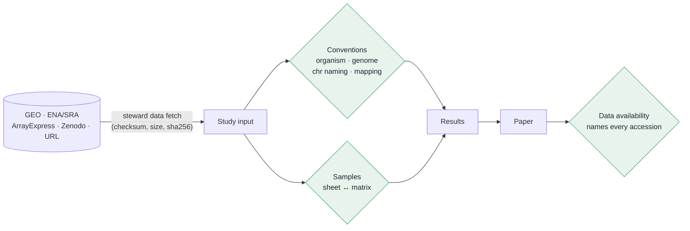

# Work with public data: fetch, conventions, samples, data availability

Reanalyses of public data fail quietly in four places: the file you analysed is not the one the archive serves, the
files of a study disagree on organism, genome or chromosome names, the sample sheet and the matrix disagree, and the
paper does not name every dataset it used. Bio-STEWARD checks each of them on every `steward check`, offline.



| Check | Where it is declared | Rule |
|---|---|---|
| The file is the one fetched (sha256, size, the archive's md5) | `[[inputs]]` of a study, written by `steward data fetch` | R-75 |
| An input declares the same organism, taxon, genome, coordinate base and chromosome naming as its study | `[references]` and `[inputs.references]` | R-75 |
| A BED, GTF, GFF or VCF file names its chromosomes the way the study says (`chr1`, `1` or `NC_000001.11`) | `chromosome_naming` | R-75 |
| The identifier mapping table is the version recorded | `[references] mapping` | R-75 |
| Every sample has the required fields and allowed values; matrix columns and sheet rows match | `[samples]` | R-75 |
| The paper's data-availability statement names every accession of the studies that cite it | the paper's `spec.toml` | R-85 |

## Fetch with provenance (`steward data fetch`)

```bash
steward data fetch GEO:GSE7621 --study pd-substantia-nigra             # the series matrix
steward data fetch GEO:GSE7621 --file GSE7621_RAW.tar --study …         # a supplementary file
steward data fetch ENA:SRR1234567 --study …                             # every FASTQ of a run (SRA: works too)
steward data fetch ArrayExpress:E-MTAB-1234 --file samples.sdrf.txt --study …
steward data fetch Zenodo:1234567 --study …                             # every file of a record (--file to pick)
steward data fetch https://example.org/table.tsv --sha256 HEX --study …  # a plain URL, with the checksum you were given
steward data fetch GEO:GSE7621 --study … --dry-run                      # where each file comes from and goes
```

Files go to `data/raw/ACCESSION/` (or `--dest`, inside the repository and never through a link). A broken download
resumes from its `.NAME.part` file. When the archive publishes a checksum (ENA and Zenodo give md5) or a size, the
file must match it; with `--sha256`, so must the sha256. A mismatch removes the partial file and records nothing.
On success the study gets one `[[inputs]]` table:

```toml
[[inputs]]
id = "GSE7621"
source = "GEO"
accession = "GSE7621"
retrieved = 2026-11-25
files = [{ path = "data/raw/GSE7621/GSE7621_series_matrix.txt.gz", sha256 = "1389f0dc…", size = 3450662,
           url = "https://ftp.ncbi.nlm.nih.gov/geo/series/GSE7nnn/GSE7621/matrix/GSE7621_series_matrix.txt.gz" }]
```

This is the only command here that uses the network. Checks read the recorded files and never fetch.

## Conventions that break reanalyses (B3)

```toml
[references]
genome = "GRCh38"
annotation = "GENCODE 44"
id_namespace = "Ensembl gene"
organism = "Homo sapiens"
taxon = 9606
coordinate_base = 0                # 0 (BED, half-open) or 1 (GTF, VCF, SAM)
chromosome_naming = "ucsc"         # ucsc (chr1) | ensembl (1) | refseq (NC_000001.11)
mapping = { path = "data/probe-to-gene.tsv", version = "GPL570 annotation, NCBI GEO, 2016-08-09" }

[[inputs]]
id = "peaks"
files = [{ path = "data/peaks.bed" }]
[inputs.references]                # what this input's source declares, when it is not the study's
genome = "GRCh37"                  # FAIL R-75.convention_mismatch: lift it over first, or record why not
```

The mapping table is fingerprinted like an input (`steward study fingerprint ID --write`). Across studies,
`[studies] consistent = ["genome", "organism", "chromosome_naming"]` reports studies that disagree.

## Sample metadata (B4)

```toml
[samples]
path = "data/samples.tsv"
id_column = "sample"
required = ["organism", "tissue", "condition", "batch"]   # the default; list the fields your design needs
allowed = { condition = ["control", "case"], sex = ["female", "male"] }
matrix = [{ path = "data/raw/GSE7621/GSE7621_series_matrix.txt.gz" }]   # skip_columns = 1; subset = true
```

Each finding names the file and row: a required field that is absent or empty (`NA`, `unknown`, `-` and similar
count as empty), a value outside `allowed` (`Case` is not `case`), a duplicate sample ID, a matrix column with no
row in the sheet, and a sheet row that is not a column of the matrix (unless `subset = true`). A GEO series matrix
is read after its `!series_matrix_table_begin` line. The matrix must also be a recorded input of the study.

## Data availability (B5, R-85)

In the paper's `spec.toml`, name the file that holds the statement:

```toml
data_availability = "data-availability.md"      # relative to the paper's folder
```

Without it, R-85 reads the section under a "Data availability" (or "Data and code availability") heading in the
paper's sources, LaTeX or Markdown. Every accession recorded by a study that lists the paper must appear in it;
`GSE1` never matches `GSE10`. A missing accession is INCOMPLETE, with the studies that used it.

## See it end to end

```bash
steward example biology my-example && cd my-example && steward check --summary
```

The [worked biology example](https://github.com/MuizZer07/Bio-STEWARD/tree/main/examples/biology-geo) fetches
GSE7621, checks its 25 samples, runs a pre-written differential-expression plan with the standard library, checks
the output tables, and traces every number in a short paper to its source. Its README lists five ways to break it
on purpose and what each check then says.

---

2026-11-25 · STW-011, STW-013, STW-014, STW-015 · Claude Code (VS Code extension) · Anthropic · `claude-opus-5-5`.
