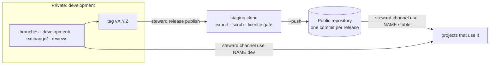

# Publish stable releases, keep development private

Steward supervises two repositories for a project: the **private development repository** (`origin`, where every
branch, record and review lives) and the **public repository**, which receives one clean commit per release.



## Set it up once
```bash
steward release setup            # asks: mirror (A) or open development (B), the public repository, the public author
# or, for an agent:
steward release setup --mode mirror --remote https://github.com/org/tool.git \
  --author "Name <your no-reply address>"
```
This writes a `[publish]` table. Your working checkout and its `origin` are never changed.

## Publish a release
```bash
steward release publish v1.2.0 --dry-run    # export the tag's public files and scan them; writes nothing
steward release publish v1.2.0              # commit and tag it in the staging clone (.steward/publish/)
steward release publish v1.2.0 --push       # push that commit and tag to the public repository
steward release status                      # the last public release; what is not yet published
```
What publishing does:
- exports the **tag** (never the working tree), keeping `[publish] include` minus `exclude`; `development/`,
  `exchange/` and `.steward/` are never published;
- removes private item IDs (`ABC-REQ-012`) from the published changelog;
- refuses on any term-list hit, local path with a user name, or open licence finding (R-79 – R-81);
- commits as the declared public author, so your private address never appears.

The public history reads one commit per release; the changelog is its timeline. Outside pull requests on the public
repository are carried back to the private one by hand.

## Use the stable or the development version
A project that uses another of your tools declares both sources once:
```toml
[[channel]]
name = "bio-steward"
stable = "git+https://github.com/org/tool.git"
dev = "git+ssh://…/tool-dev.git"   # the private development repository
installer = "uv-tool"     # or pipx, pip
```
```bash
steward channel use bio-steward stable --tag v1.2.0 --yes   # test the public release
steward channel use bio-steward dev --yes                   # back to development
steward channel status
```

## Check for a CLI upgrade

```bash
steward upgrade --check
steward upgrade --to 0.21.0
```

`steward upgrade --check` reports the installed and newest known versions, the install method (a stable or dev
channel when the install matches the `[[channel]]` declaration above) and the exact install command; `--to` runs it
after you confirm in the terminal. See [Upgrade the CLI](upgrade.md).

## Later: open development (model B)
`steward release setup --mode open` prints the plan: move `development/` and `exchange/` to a private records
repository (`[paths] records`), and the history's author addresses and commits with private content, with two
options: a fresh public history at the next release, or a rewrite (only with a signed approval). It moves, rewrites
and pushes nothing itself.

## Go public in one command

When a project that has been developed privately goes public with a release mirror, the whole procedure is one
command:

```bash
steward release go-public --owner OWNER --name NAME            # readiness and the plan; nothing changes
steward release go-public --owner OWNER --name NAME --apply    # run it
```

1. **Readiness.** The latest `v*` tag (or `--tag`) is exported and scanned exactly as `release publish` would: private
   item IDs and terms, local paths, binary files, and the licence gate at public strictness. Each kind of finding
   comes with its fix. `--apply` refuses while any remains.
2. **The plan**, in order: rename the development repository to `NAME-dev` (it stays private; GitHub redirects the
   old address until the public repository takes the name), point `origin` at it, create the public repository
   `NAME` **private**, record `[publish] remote` if missing, and publish the tag.
3. **`--apply`** runs the steps with `gh` and `git`, stops at the first failure and says what was done. It refuses
   when the public repository exists already.
4. **Look, then make it public.** The release repository is created private, so you can check what strangers will see
   (the README, the files, the one release commit, the tag) before anyone can; the command prints the last step:
   `gh repo edit OWNER/NAME --visibility public --accept-visibility-change-consequences`. `--public` creates it public
   at once.

After it, every release is `steward release publish vX.Y.Z --push`; development continues in `NAME-dev`.
