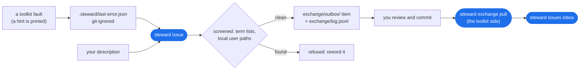

# Report a toolkit defect

When `steward` itself goes wrong in your project, `steward issue` writes a defect report into your exchange outbox,
screened for private details, for the toolkit's maintainers to receive. Nothing is sent: filing needs no network, and
nothing is captured unless you run the command.



## File a report

Run `steward exchange init` once in a project with `[exchange]` configured. Then:

```bash
steward issue "The summary omitted the rule details"
steward issue --from-last-error
```

- **A description.** Use the first form for a toolkit problem you can describe in generic terms. The report is
  screened against the project's term lists and for local user paths. Keep project details in your own records.
- **The last fault.** When the CLI meets a fault of its own, it prints a hint and keeps a diagnostic in
  `.steward/last-error.json` (git-ignored, replaced at the next fault, yours to delete at any time). The record holds
  the error type, toolkit file and line references, a fingerprint, the installed version, the command name, the flag
  names and the exit code: never argument values or file contents. `--from-last-error` files it.

Reports go to `STW` by default; set `to` under `[report]` in `steward.toml` to choose another exchange recipient.

Filing writes a defect item in `exchange/outbox/` and records it in `exchange/log.jsonl`. Filing the same fingerprint
again while the item is open adds a `seen again` note to your ledger rather than a second item. Review and commit the
item and ledger so a maintainer can receive them from a local peer.

## Read received reports (the toolkit side)

```bash
steward issues inbox
steward issues inbox --format json
```

`steward issues inbox` groups received reports by fingerprint, with counts, versions, sender codes and item IDs. Counts
reflect received items; repeat notes stay in the sender's ledger. The JSON form is `steward.issues_inbox/0.1`.

See also [Multi-project governance](multi-project.md) for the exchange folder and its receipts.
