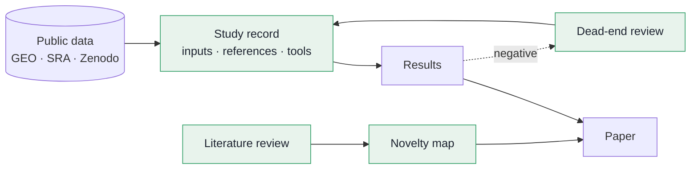

# Keep the research record: studies, reviews, novelty, dead ends

Most of what decides a research project happens in conversation: which dataset, which annotation release, what the
literature says, whether a result is new, what to do after a negative result. Bio-STEWARD keeps those as small TOML
records next to the code, checks them, and shows them on the project's site.



## Study records (`[studies]`, R-75)
One file per study: a GEO reanalysis, an experiment, a claim and its plan.

```bash
steward study new gse5281-ad --title "GSE5281 Alzheimer's reanalysis" --kind reanalysis
# fill in inputs, references, tools, results, papers
steward study fingerprint gse5281-ad --write   # records each file's sha256
steward study show gse5281-ad                  # the study card
```

```toml
[[inputs]]
id = "GSE5281"
source = "GEO"
accession = "GSE5281"
retrieved = 2026-11-20
files = [{ path = "data/GSE5281_series_matrix.txt", sha256 = "…" }]

[references]
genome = "GRCh38"
annotation = "GPL570 annotation, 2026-10"
id_namespace = "Entrez"
databases = { GO = "2026-10-01", Reactome = "v90" }
```

What R-75 catches:

| You did | R-75 says |
|---|---|
| Re-downloaded a series and the file changed | **FAIL** `file_changed`, and every study that builds on it is **stale**, with the papers that cite them |
| Used the same input in two studies | listed as `duplicate_input`: the same raw file (for example one microarray `.CEL` file deposited in two GEO series) counted twice |
| Mixed GRCh37 and GRCh38 across studies (`consistent = ["genome"]`) | **INCOMPLETE** `inconsistent_references` |
| Froze a study with a file not fingerprinted | **FAIL** |

## Research-direction records (`[research]`, R-76, advisory)
| Kind | For | Command |
|---|---|---|
| 📚 `review` | a literature review: question, date, method, every source and why | `steward research new review ID --title …` |
| ✨ `novelty` | each contribution, its nearest prior work (also your own papers), how it differs | `steward research new novelty ID …` |
| 🧩 `gaps` | gaps, flaws, limitations, threats, each with its decision | `steward research new gaps ID …` |
| 🧭 `dead-end` | negative results, the options with evidence, the decision | `steward research new dead-end ID …` |

R-76 is advisory: the default gate never requires it (a gate you name can). It says when a review is older than `stale_days`, when a contribution names no nearest
work, and when a dead end has no decision. New records start as `status = "draft"` and R-76 says so until the template's examples are replaced. The
**research-review** skill tells an agent how to fill them; the human decides.

## Hand the work to another agent: briefs
```bash
steward task template analysis-review > development/tasks/AR-001.md     # or review, reverification, literature-review, novelty-check, figure-check
steward task brief development/tasks/LR-001.md --for codex > brief.md   # codex | gemini | claude | generic
```
The brief is generated from the task file: the goal, scope, rules, acceptance criteria and the repository state, with
the agent's own conventions. It passes your term lists before it is printed.

## Compare runs, and see them
```bash
steward diff runs --label "model-*" --svg runs.svg     # a table, and a chart of duration (or --metric memory)
```
The project site's **Runs** page draws the same chart; **Studies** and **Research records** pages show the cards.
Add them with `[docs] publish = ["overview", "runs", "studies", "research"]`.

## Evaluating language models (`[llm_eval]`, R-78)
In a benchmark contract:
```toml
[llm_eval]
cases = "benchmarks/cases.csv"    # id, published, group, split (tune | dev | test)
prompts = "prompts"               # a [[frozen]] set
[[llm_eval.models]]
name = "model-x"
training_cutoff = 2025-12-31
[[llm_eval.models]]
name = "judge-y"
role = "judge"
```
R-78 fails a study (group) in both tuning and test, a case recorded twice with different splits, and a model judging
itself. It reports test cases public before a candidate's *stated* cutoff (possible exposure; a cutoff is the
provider's statement, not evidence of what the model saw), unknown cutoffs, missing evidence, and prompts whose
[[frozen]] set is not recorded and intact (R-63).

## Citation verification (optional, R-77)
For a paper whose citations must be checked, add `citations = "citations.toml"` to its `[paper.NAME]` table and run
`steward paper citations NAME --fetch`: each DOI (Crossref) or PMID (PubMed) is resolved once and its title recorded.
R-77 then fails any citation whose recorded title is not the cited one. Checks never use the network.
