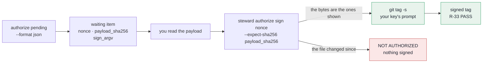

# Sign ahead, or sign later

Signed approvals keep an agent from changing policy or spending money without you. They also need you at the
keyboard. When agents work for a day while you are away, choose one of two ways for each kind of approval before you
leave.

| Way | For | When you sign |
|---|---|---|
| **Sign ahead** | spend, runs and unsealing a named dataset: approvals that do not bind exact file contents | before you leave, with a budget and an expiry |
| **Sign later** | policy changes, which bind the exact new policy files | when you are back, all at once |

## Sign ahead: a budget and an expiry
An authorization carries a scope, a budget and an expiry. Sign one in the morning that ends with the working day:

```bash
steward authorize prepare spend --object development/spend-plan.toml --budget "20 USD" \
  --expires 2026-11-25T20:00:00Z --summary "today's paid calls"
steward authorize sign <nonce>          # your key's prompt is the approval
```

The agents use it all day; after the expiry, the next call is refused.

## Sign later: the queue
A policy change cannot be signed before it exists, because the signature binds the new policy files. An agent that
changes them prepares the approval and goes on:

```bash
steward authorize prepare policy.change --expires 2026-11-26T20:00:00Z \
  --summary "add the quick gate"
```

`prepare` uses the policy bundle hash that R-33 checks. It refuses when the policy files match the baseline. If you
pass `--object`, give the exact `R-33.object` value. A mismatch reports the supplied value and the expected hash.
For a single approval, run `steward authorize sign <nonce>`. Before the key prompt, it reports whether the payload
matches the current R-33 object. If the policy changed since preparation, prepare a new payload for the current files.

To sign only the bytes you read, pass their hash. `steward authorize pending --format json` reports each payload's
`payload_sha256`. If the file changed since then, `sign` refuses and signs nothing:

```bash
steward authorize sign <nonce> --expect-sha256 <payload_sha256>
# steward: NOT AUTHORIZED: sign: the payload changed since it was shown: its sha256 is …, expected …; nothing signed
```

Each waiting item of `steward authorize pending --format json` also carries that command line, ready to run:
`sign_command` (a shell line) and `sign_argv` (the same as a list of arguments, to run without a shell). For a peer
project listed with `--all-projects`, it adds `--repo` with the peer's checkout. An item that cannot be signed here
(`signed`, `expired` or `foreign`) has both as null. The command signs nothing by itself: `git tag -s` still asks for
your key.



While the policy files are exactly the prepared ones, R-33 is **INCOMPLETE** ("awaiting your signature"), not FAIL:
commits continue (the pre-commit hook blocks only on FAIL), and every gate that requires R-33 stays NOT ELIGIBLE until
you sign. Any further edit to the policy files is a FAIL again.

When you are back:

```bash
steward authorize pending --all-projects    # every waiting approval, here and in the [exchange] peers
steward authorize sign-pending --all-projects
```

`sign-pending` shows each payload and asks before it signs; your key's own prompt is still the approval. Each
prompt names the payload's action and SHA-256:

```text
payload sha256 3f9c…e1  action policy.change
Sign . 4b7d2a90c1e3: action policy.change, payload sha256 3f9c…e1? [y/N]
```

A payload cannot hide text from you. Its control and invisible characters (terminal escapes, carriage returns,
bidirectional and zero-width characters, bytes that are not UTF-8) are printed as escapes (`\x1b`, `\r`,
`\u202e`, `\xff`), and a backslash as `\\`. A warning counts them; do not sign such a payload unless you know why
they are there. A payload that changed between the listing and the read is skipped. An expired
preparation is listed as expired and never holds the check. In the one-line listing of `steward authorize pending`,
a line break in a summary is shown as `\n`, so each payload stays on its own row.

A payload is signed only in the repository it names. One whose `repo_id` is not the project's (in its
`steward.toml`) is listed with the state `foreign` (in text and in `--format json`), is never counted as waiting,
and `sign`, `sign-pending`, `next` and `notifications` never offer it:

```bash
steward authorize sign <nonce>
# steward: NOT AUTHORIZED: repo_id: the payload belongs to repository 'other', not this one (…); nothing signed
```

`steward.toml` is in the working tree, where an agent can edit it. When you have pinned the trust root for this
checkout (`steward authorize pin`), the pin's repo_id counts: if `steward.toml` names another one, nothing is signed
and every pending payload is listed as `foreign`, as R-33 already does for a policy change.

The signed tag holds the payload byte for byte: `git tag` runs with `--cleanup=verbatim`, so a repository setting
such as `core.commentChar` cannot remove lines from what you sign. A payload larger than 1 MiB, or one that is not
UTF-8, is refused; closing the prompt's input (Ctrl-D) answers no.

## What is not offered
There is no "approve any policy change today". It would let an unattended agent rewrite the policy, which is what
R-33 exists to catch.
