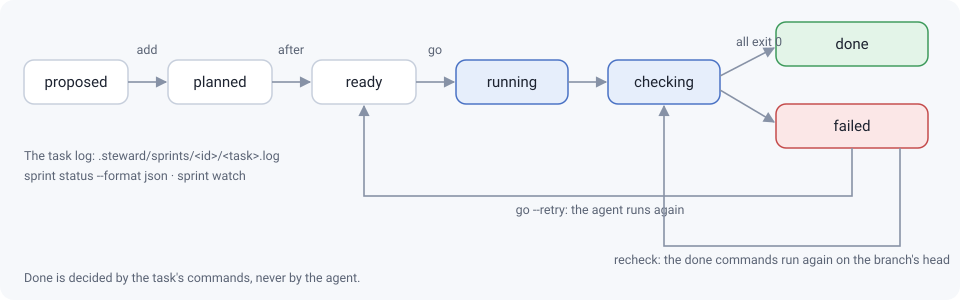

# Run a supervised sprint

A sprint is a list of tasks for a window of time (a day, an afternoon), each done by a coding agent or a command,
started one by one when you give the order. Steward supervises each through `steward run` (time and hang limits, the
run ledger), keeps each in its own branch, and decides that a task is done only when its commands pass. It never
merges, approves or signs for an agent.



## 1. Plan
```bash
steward sprint plan day1                       # from the board's open tasks
steward sprint plan day1 --from exchange       # from the open requests of other projects
steward sprint plan day1 --milestone ismb-2027 # from a milestone's open tasks
```
Edit `development/sprints/day1.toml`:

```toml
schema = "steward.sprint/0.1"
[sprint]
id = "day1"
window = { start = 2026-11-25T09:00:00+00:00, end = 2026-11-25T18:00:00+00:00 }
max_parallel = 2
dispatch = "order"          # tasks start only on `steward sprint go`; "auto" starts each when what it waits for is done

[[task]]
id = "T1"
title = "Fix the leakage check for grouped splits"
ref = "BP-110"
agent = "claude-code"        # claude-code | codex | antigravity | shell
model = "opus"
prompt = "Resolve BP-110. Write the regression test first."
permissions = "edit-and-run" # read-only | edit (the default) | edit-and-run
allow = ["make test"]        # command prefixes the agent may also run
deny = ["rm -rf"]            # added to the default deny list
requires = []                # what the run must offer: display, network
after = []
limits = { wall_minutes = 90, idle_minutes = 15 }
done = ["python -m pytest -q", "steward check --gate default"]
needs = ["spend"]            # signatures it will need: policy.change, spend, unseal, amend, waiver
```

`steward sprint check day1` validates it (no cycles, every task has `done` commands), prints the permissions each task
runs with, and lists the signatures needed. Optional settings under `[sprint]`: `base = "main"` (the branch the work
starts from and merges into; default: the branch checked out) and `worktree_root = "~/wt"` (where the worktrees go;
default `.steward/sprints`). Tools with path limits fail in deep worktrees: a Unix socket path, for example, may be
at most about 104 characters, so a short `worktree_root` helps.

## Permissions
A headless agent refuses every tool that needs approval, so each adapter maps the task's `permissions` to the agent's
own flags:

| `permissions` | Claude Code | Codex | Antigravity |
|---|---|---|---|
| `read-only` | reads, read-only git; edits refused | `-s read-only` | read-only commands |
| `edit` (default) | `acceptEdits`; edits, `git add`, `git commit` | `-s workspace-write`; committed by the sprint after it exits | read-only commands, `git add`, `git commit` |
| `edit-and-run` | as `edit`, and any command | as `edit` (its sandbox runs commands either way) | as `edit`, and the build and test commands of `task dispatch` that an `allow` entry may name (never `env`, `python`, `python3`, `awk`, `uv` or `git` as a whole) |

Every agent task also gets the **default deny list**: `git push`, `git merge`, `git rebase`, `git reset`, `git tag`,
`git update-ref`, `git filter-branch`, `steward authorize|release|spend|unseal|sprint`, `gh release`, `gh pr merge` and
the publishing commands of npm, twine, uv and cargo. A task's `deny` adds to it; an `allow` entry that names one of
them makes the sprint file invalid. An `allow` entry is compared in a normal form: spaces collapsed, a program path
read as its name (`/usr/bin/git push` is `git push`), wrappers removed (`env`, `sh -c`, `bash -c`, `nohup`, `xargs`,
`uv run`), git's global options removed (`git -C dir push` is `git push`) and `python -m steward.cli` read as
`steward`, all in lower case (a case-insensitive file system runs `GIT` as `git`). An entry that covers a denied
command is refused too: `git`, `git*`, `steward`, `gh`, `env`. Name the exact prefix instead.

**What an `allow` entry may be.** Broad forms are refused outright rather than read option by option:

- its first word may not be a shell, a wrapper or a launcher: `env`, `sudo`, `doas`, `nohup`, `xargs`, `command`,
  `exec`, `time`, `nice`, `timeout`, `stdbuf`, `strace`, `script`, `sh`, `bash`, `zsh`, `dash`, `ksh`, `fish`,
  `csh`, `tcsh`, `uvx`, `npx`, `pipx`, `pnpx`, `bunx` and a few more of the same kind;
- it may not start with an interpreter, versioned or not (`python`, `python3.13`, `node`, `perl`, `ruby`, `awk`, …),
  except `python -m pytest` or `python3 -m pytest`, with no option before `-m`;
- a program that has a denied subcommand (`git`, `gh`, `npm`, `uv`, `cargo`, `twine`, `steward`) needs that
  subcommand named, with no option before it; subcommands that run other commands (`npm exec`, `uv tool`, `gh api`,
  `git config`, `steward run`, …) are refused;
- `uv run PROGRAM` is checked again on PROGRAM by these rules. Only `-q`, `--frozen`, `--locked`, `--offline`,
  `--no-sync`, `--all-extras`, `--dev`, `--no-dev`, `--extra X`, `--group X` and `--package X` may come before it;
- shell characters and globs (`; & | $ < > * ?`, backticks) are refused.

| Accepted | Refused (why) |
|---|---|
| `make test`, `npm test`, `npm run build` | `env -u HOME git push` (a wrapper) |
| `git status`, `git diff` | `bash -o errexit -c 'git push'` (a shell) |
| `pytest`, `python -m pytest`, `python3 -m pytest -q` | `python3.13`, `python3 -P -m steward.cli authorize` (an interpreter) |
| `uv run pytest`, `uv run --extra dev python -m pytest` | `uv --no-config publish`, `npm -s publish`, `cargo +nightly publish` (an option before the subcommand) |
| `gh pr view`, `cargo test`, `steward check` | `uvx twine upload`, `npx steward authorize` (a launcher); `GIT push` (a denied command) |

A command the agent may run can still run others through the project's own files (`make test` runs the Makefile,
`npm run build` the package's scripts). An `edit` task can change those files, so a reviewer reads them with the
branch.

Claude Code receives the lists as `--allowedTools` and `--disallowedTools` (a denied pattern wins over an allowed
one); Antigravity receives them in a session-only settings file. **Codex has no list of commands**: its prompt names
the denied commands, but nothing enforces them; its sandbox enforces only a read-only `.git` and, unless
`requires = ["network"]`, no network. With network on, publishing commands are not blocked. `sprint check` says so
for each Codex task. These are patterns, not a sandbox: a command can still be reached in a form no pattern names
(for example under an `edit-and-run` task's general `Bash`), so keep the branch protections on the remote.

**Claude Code's Edit and Write are not limited to the worktree.** With `edit` or `edit-and-run`, a Claude Code task
can write any file the user can, the sprint file and its ledger in the main checkout included; only its prompt asks
it not to. The dispatcher guards its own inputs (see *Changes to the sprint file while it runs* below), but run
such tasks inside an operating-system sandbox or a separate user account when the files outside the worktree matter.

Codex's sandbox cannot write `.git`, so a Codex task's work is committed after Codex exits, with the message
`TITLE (sprint ID, TASK; written by Codex, committed by the sprint task)`. That commit step runs outside Codex's
sandbox, so it runs git with no hooks (`core.hooksPath=/dev/null`, `--no-verify`), no fsmonitor and no
repository-selected programs. Codex's sandbox has no display: a task with
`requires = ["display"]` (GUI or editor-host tests) cannot use the codex adapter.

## 2. Signatures before you leave
For each signature the tasks need, `check` and `start` say how to handle it: **sign ahead** (spend, unsealing: a
budget and an expiry at the end of the window) or **sign later** (policy changes: they wait for
`steward authorize sign-pending`). See [Sign ahead, or sign later](signing-ahead.md).

## 3. Run
```bash
steward sprint go day1 T1          # the order for T1
steward sprint start day1          # dispatch what has its order; returns when nothing more can start
steward sprint start day1 --watch  # stay: orders, retries and rechecks until every task is finished, the window ends or `sprint stop`
steward sprint status day1 [--format json]
steward sprint watch day1          # one line per new event; ends when nothing runs and nothing ordered waits
steward sprint hold day1 T2 / skip day1 T2 --reason "…" / go day1 T2 --retry
steward sprint recheck day1 T2     # a failed task whose work is fixed on its branch: run its done commands again
steward sprint add day1 T13        # a task written into the file after the sprint opened
steward sprint reload day1         # use an edit of the sprint file made while a task ran
steward sprint stop day1 [--now]   # --now also stops the running tasks (each run records its interruption)
```
Each task runs in `.steward/sprints/<sprint>/<task>` (or under `worktree_root`) on the branch `sprint/<sprint>/<task>`.
When its run ends, its `done` commands run there: all exit 0 and nothing uncommitted → **done**; otherwise **failed**
(an uncommitted change is named by its path), and what waits for it is **blocked**. Nothing starts outside the
window, or when it could not finish before the window ends; `status` says when the window is not open. Done commands
can use `STEWARD_SPRINT_BASE`, `STEWARD_SPRINT_BRANCH`, `STEWARD_SPRINT_TASK` and `STEWARD_SPRINT_ID` instead of
naming the base branch.

### Changes to the sprint file while it runs
The dispatcher reads the sprint file again before each dispatch, **while no task runs**: an edit is printed, recorded
in the ledger, and used from then on (an invalid edit is not used). An edit made **while a task runs** (by you, or by
an agent that wrote outside its worktree) is recorded and not used, also after that task ends, until you order it:
`steward sprint reload day1` (an order by the human in the ledger). A running task always keeps the definition it
started with (its command, done commands and permissions): a change to it is recorded as refused and never run; its
next attempt (`go --retry`) uses the file as reloaded. Several worktrees and log folders are made one folder at a
time without following a link, so a linked `.steward/sprints` cannot move them outside the repository. A task added
to the file after the sprint opened waits as **proposed** until `steward sprint add` records it.

## Watch a running sprint
Each task's output goes to `.steward/sprints/<sprint>/<task>.log` (git-ignored, so never in a published export).
The agent adapters ask for their JSON event stream (Claude Code `--output-format stream-json`, Codex `--json`), so
`steward sprint status day1 --format json` (`steward.sprint_status/0.1`) can name, for each task, its run and logs,
its start and end, the commits and changed files on its branch, the last commit's subject, its checks with their exit
codes, and its last tool step: the tool and its command or path on one line, never a file's contents.
`steward sprint watch day1` prints the same as events:

```text
09:02:11 T1 running (claude-code) on sprint/day1/T1; log .steward/sprints/day1/T1.log
T1 step Bash: python -m pytest -q
T1 commit 3f2a1c9e0b4d Fix grouped splits
09:41:57 T1 checking
09:43:02 T1 done: 2 of 2 checks passed (python -m pytest -q -> 0; steward check --gate default -> 0)
```

Both read the ledger, git and the task logs; no model is called.

## When to commit the ledgers
The sprint ledger (`development/sprints/<id>.jsonl`) and the run ledger are written in the main checkout while the
sprint runs, so `git status` shows them changed. Commit them with each merge of a task's branch, and once more with
the report.

## 4. Report and merge
`steward sprint report day1` writes `development/sprints/day1-report.md`: each task, its agent, its state, its
checks, whether its branch is merged (read from git), and the branches still waiting for your merge. Review and merge
them yourself.

For scripts that gate on `steward check`: its exit code is the gate's, so a FAIL outside every gate exits 0. Use
`steward check --fail-on fail` (or `--fail-on incomplete`) to exit non-zero on any such result.
