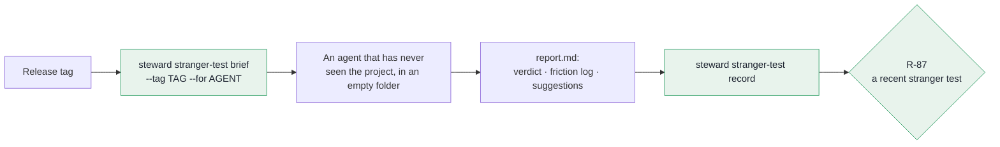

# Run a stranger test before a release

The people who build a project can no longer see it the way a newcomer does. A **stranger test** gives a release to an
agent that has never seen the project: it installs the release in an empty folder, reads only what a newcomer would
(the README, the user guide, `--help`), tries to get real value from it in about an hour, and writes down every point
of friction. The report says whether its intended audience would keep using it, and why.



## Declare what a stranger should try

In `steward.toml` (every key is optional; without the table the generic test runs):

```toml
[stranger_test]
audience = "a data engineer who has just found this library"
missions = [
  "Load your own CSV and get the summary report the README shows.",
  "Connect it to a database as the guide describes.",
]
may_read = ["README.md", "docs/"]                    # what a newcomer sees (default)
must_not_read = ["src/", "tests/", "development/"]   # what they cannot (default)
install = 'python -m venv env && env/bin/pip install -q "git+file://{repo}@{tag}"'   # {repo}, {tag} filled in
max_age_days = 120                                   # R-87: a record older than this is due again
```

Every brief has the same frame around your missions: **first contact** (install from the README alone and reach the
first useful result) comes first; **follow one guide exactly as written** and **break something and fix it with the
project's own help** come last. Without missions, the stranger tries "the main thing the README says this project is
for".

## Run it

```bash
steward stranger-test brief --tag v1.2.0 --for codex --output BRIEF.md
mkdir ../stranger && cd ../stranger
codex exec -s workspace-write --skip-git-repo-check -C "$PWD" "$(cat ../repo/BRIEF.md)" < /dev/null
```

`--for gemini`, `--for claude` or `--for generic` give the same brief with that agent's way to run it. Use an agent
that has not worked in the repository, in a folder of its own.

## Keep the result

```bash
steward stranger-test record ../stranger/report.md --tag v1.2.0 --agent codex
```

The report is filed as `development/assessment/DATE-stranger-test-TAG-AGENT.md` and never overwritten. R-87
(advisory) passes while the latest record is younger than `max_age_days`; it is INCOMPLETE when there is none, or the
last one is old. Require it before releases with a named gate: `[gates.release] require = [..., "R-87"]`.

## What the report holds

| Part | What it tells you |
|---|---|
| **Verdict** | Would the audience keep using it after an hour, and why. |
| **Friction log** | Per mission: where they were unsure, what they tried, what happened, marked blocking / slowing / cosmetic, with timings. |
| **Unclear words** | The project's jargon, as a newcomer met it. |
| **Output read** | How much each command printed (useful when agents use the tool). |
| **Suggestions** | Ranked capabilities that would make it more useful to its audience, each with the problem it prevents. |

Two strangers (two different agents) find different things. Fix the blocking items before the release; take the
suggestions to your planning.

---

2026-11-25 · STW-041 · Claude Code (VS Code extension) · Anthropic · `claude-opus-5-5`.
