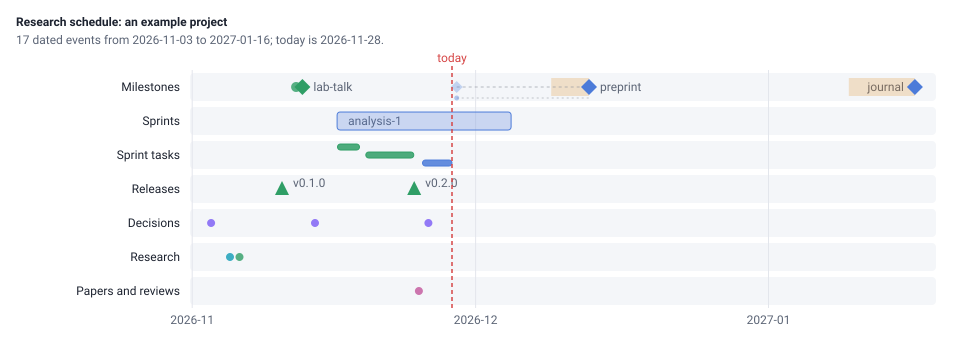

# Plan to a deadline: milestones and the timeline

A preprint, a conference submission, a release: each is a dated goal with work that must be done before it.
`steward timeline` shows how far each one is, from the project's own records.

## Declare the milestones
`development/milestones.toml`:

```toml
schema = "steward.milestones/0.1"

[[milestone]]
id = "ismb-2027"
title = "ISMB 2027 submission"
due = 2027-01-20T23:59:00-12:00     # the real deadline, with its time zone (anywhere on earth here)
kind = "submission"                 # submission | preprint | release | review | other
gate = "submission"                 # the gate that must be ELIGIBLE (for a paper: steward check --final)
tasks = ["BP-110", "BP-111"]        # board tasks (needs [tasks])
items = ["REQ-019"]             # exchange items it waits on
needs = ["policy.change"]           # signatures it will need
buffer_days = 3                     # your internal deadline: due minus the buffer
```

## List project plans

Run `steward plans` for a terminal summary or `steward plans --format json` for CI and automation.
The JSON document uses `steward.plans/0.1`. Each row gives its project-relative `path` and one-based `line`.
The command reads local records and Git history.

The date used for sorting comes from the milestone's due time, the sprint's window start, the release tag or
specification signature, or the roadmap row's date. Dated plans appear newest first. Undated plans follow in
descending natural ID order.

- **Milestones** use the state and progress from `steward timeline`. Drift shows the recorded deadline moves,
  scope or order findings, and changes that affect that milestone.
- **Sprints** show the window state and task states from `steward sprint status`. The done count includes tasks
  in the `done` state. Once the sprint opens, drift shows tasks in the file that are outside the ledger's plan
  and tasks in that plan that are missing from the file.
- **Release specifications** under the records folder's `design/` directory show whether a matching local
  release tag exists. Drift compares the current specification with the one at that tag when available.
- **Roadmap rows** in the project's index show the recorded state and progress for task IDs linked to the
  configured board. Progress is null when no board task matches. Drift shows changes to the row and any
  missing task reference reported by the timeline.

<figure>
<svg xmlns="http://www.w3.org/2000/svg" viewBox="0 0 620 132" width="100%" role="img" aria-labelledby="plans-title plans-desc">
<title id="plans-title">Tasks completed in the example plans</title>
<desc id="plans-desc">The review milestone has one of one tasks done. The sprint has one of two tasks done.</desc>
<style>
  .bg { fill: #ffffff; } .ink { fill: #1d2330; } .muted { fill: #5b6475; } .grid { stroke: #e3e6ec; }
  @media (prefers-color-scheme: dark) {
    .bg { fill: #14171f; } .ink { fill: #e8ebf2; } .muted { fill: #a3abba; } .grid { stroke: #2a2f3b; }
  }
  text { font-family: -apple-system, 'Segoe UI', Roboto, sans-serif; font-size: 12px; }
</style>
<rect class="bg" width="620" height="132" rx="10"/>
<text class="ink" x="16" y="26" font-weight="600" font-size="15">Tasks completed</text>
<line class="grid" x1="180.0" y1="38" x2="180.0" y2="104"/>
<text class="muted" x="180.0" y="120" text-anchor="middle">0 %</text>
<line class="grid" x1="272.5" y1="38" x2="272.5" y2="104"/>
<text class="muted" x="272.5" y="120" text-anchor="middle">25 %</text>
<line class="grid" x1="365.0" y1="38" x2="365.0" y2="104"/>
<text class="muted" x="365.0" y="120" text-anchor="middle">50 %</text>
<line class="grid" x1="457.5" y1="38" x2="457.5" y2="104"/>
<text class="muted" x="457.5" y="120" text-anchor="middle">75 %</text>
<line class="grid" x1="550.0" y1="38" x2="550.0" y2="104"/>
<text class="muted" x="550.0" y="120" text-anchor="middle">100 %</text>
<text class="ink" x="170" y="57" text-anchor="end">Milestone review</text>
<rect x="180" y="44" width="370.0" height="18" rx="4" fill="#4c7bd9"><title>Milestone review: 100 % (ready)</title></rect>
<text class="muted" x="556.0" y="57">100</text>
<text class="ink" x="170" y="83" text-anchor="end">Sprint example</text>
<rect x="180" y="70" width="185.0" height="18" rx="4" fill="#4c7bd9"><title>Sprint example: 50 % (open)</title></rect>
<text class="muted" x="371.0" y="83">50</text>
</svg>
<figcaption>The example review milestone has one of one tasks done. The sprint has one of two tasks done.</figcaption>
</figure>

*Section record — 2026-11-28 · P01 implementation · Codex (harness version unknown) · OpenAI ·
model ID unknown · The figure uses the worked example test records.*

## Read the timeline
```bash
steward timeline          # soonest first
steward timeline --format json   # versioned milestones and drift
steward timeline --json   # legacy milestone output
steward timeline --now 2027-01-18T00:00:00Z   # as it will stand then (0.21.0), to reproduce "at risk"
```

Each milestone shows the days left and its progress:
- **gate:** ELIGIBLE or not, how many required rules pass, which block;
- **tasks:** done of total, and which are open (from the board);
- **items:** settled of total, and which are still waiting;
- **signatures:** which are needed, and which wait in the signing queue (`steward authorize sign-pending`).

Its state is **ready** (nothing open), **on track**, **at risk** (work open after the internal deadline, or more than
three pieces of open work a day in its last week), **late** (work open after the due time), or its recorded outcome.

`steward next` shows the nearest milestone with what blocks it, beside what waits on you
([Where you are, what is next, what is stale](next-and-tidy.md)).

## Read plan drift

`steward timeline --format json` includes a `drift` object in `steward.timeline/0.1`.

- `date` compares the first available committed due date with the current one, counts changes of deadline and
  identifies milestones with a recorded `moved` outcome. The day difference uses elapsed time.
- `scope` lists open or completed board tasks outside any milestone, milestone tasks that are missing, dropped or
  still unstarted, and roadmap table rows without a task reference. It reads the roadmap from the project's index.
- `order` lists started or completed tasks on a later milestone while the current records show work still open on an
  earlier milestone. Shared tasks are excluded from that pair.
- `changes` names the milestone or roadmap row, the fields changed, and the matching decision's file and line when
  available. A null `decision` marks a change without a matching record. A milestone's changed outcome can cite a
  dated decision heading exactly. Otherwise, a committed change looks for a dated log entry that mentions the
  milestone or roadmap row within one calendar day of the commit date.

The comparison uses local first-parent history and the working tree. Working-tree changes have a null commit and time.
`history` is `unavailable` when there is no local Git baseline, `shallow` for a shallow clone, or `partial`
when a snapshot could not be read. `notes` describes skipped snapshots. Drift is advisory information in the JSON
document. `--now` sets the time used to compute milestone states.

## The research timeline and the schedule

`steward timeline --events` (0.24.0) puts every dated record of the project on one time axis, newest first. Each
event names the file and line it was read from.

```bash
steward timeline --events                     # newest first, one line per event
steward timeline --events --format json       # steward.timeline_events/0.1
steward timeline --events --format svg > schedule.svg   # the schedule as a picture
steward timeline --events --all-projects      # add the projects the exchange names, when they are on disk
steward timeline --events --now 2026-11-28T12:00:00Z    # today as of then, to reproduce a picture
```



| Event | Read from | Its date |
|---|---|---|
| `milestone` | `development/milestones.toml` | the due time; `internal` is due minus the buffer; `moved_from` is the first committed due date when it differs |
| `milestone_moved` | the local Git history of `development/milestones.toml` | the commit that changed the due date, from `moved_from` to `moved_to` |
| `milestone_outcome` | `[milestone.outcome]` with `on` | the day of the outcome |
| `decision` | the dated headings of the decision logs (as `steward decisions` reads them) | the heading's day |
| `release` | the local `v*` tags | the tag's time (the source is the tag, so `path` is null) |
| `paper` | each paper's `venue.toml` | the day its requirements were retrieved |
| `review` | the reviews of `[release] findings` | the time of the reviewed commit |
| `research` | research records (`[research]`) | the record's date, the day of its search, the day of a dead-end decision |
| `sprint` | `development/sprints/<id>.toml` | its window, start to end |
| `task` | the sprint's ledger | when the task started, and when it ended |

A record without a date is left out, and the notes say what could not be dated. Nothing is fetched: tags and history
come from the local Git repository, and with `--all-projects` a peer is read only when its checkout is on disk (a peer
given as a URL is listed as not fetched). Another project's gates are not run, so its milestones carry no state.

The schedule (`--format svg`) draws one lane per kind of record (per project with `--all-projects`). A milestone is a
diamond coloured by its state, with its buffer shaded before it and its first due date as a faint diamond joined by a
dashed line. A sprint is a bar over its window, and its tasks are thin bars in the lane below (a running task reaches today). A dashed line marks today.
Milestones, releases and sprints are named beside their marks. A name never overlaps another: when two marks are close
(a release candidate and its release, a few days apart), the second name moves to a row just above the marks, and a
name that still does not fit is shortened to its end (`…0.1.0-rc`) with the full name in its tooltip. Every mark's
tooltip holds its full name and date. The picture has a title and a text alternative (the counts, the coming deadlines and the newest events), carries its own
light and dark colours, and holds no script.

## Record the outcome
When a milestone passes, record what happened; R-70 (advisory) reports a past milestone without one:

```toml
[milestone.outcome]
state = "moved"                         # met | moved | dropped
decision = "2026-12-01: moved to the March deadline"
```

## On the documentation site
Add `"timeline"` to `[docs] publish` for a Milestones page: titles, kinds, due dates and recorded outcomes. Days
left and progress change every day, so they stay in `steward timeline`.
