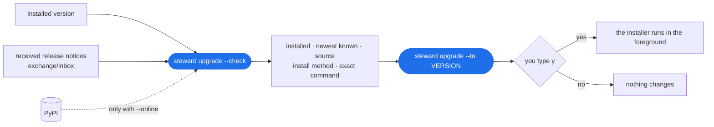

# Upgrade the CLI

`steward upgrade` answers two questions: is a newer `steward` known, and what exact command installs it? The check
is read-only and uses no network unless you ask. The install runs only after you confirm it in a terminal.



## Check

```bash
steward upgrade --check
steward upgrade --check --format json
steward upgrade --check --online --format json
```

```console
$ steward upgrade --check
Installed version 0.21.1 (uv-tool)
Newest known version 0.22.0 (exchange)
Install command uv tool install --no-config --force 'bio-steward @ git+https://github.com/MuizZer07/Bio-STEWARD.git@v0.22.0'
```

The check reads the project's received toolkit release notices (`exchange/inbox/`) by default. A notice counts only
when it is addressed to this project, is a regular file (not a link), and still has the bytes recorded when
`steward exchange receive` took it in; a file placed in the inbox by hand announces nothing. Outside a project,
or when no notice is available, the newest version is unknown (exit 0). `--online` asks PyPI for its latest release;
if that request fails, the check falls back to the local notices and says so. When `--repo DIR` names a directory
with no `steward.toml`, the command exits 78 (not configured).

The JSON result (`steward.upgrade/0.1`) reports:

| Field | Meaning |
|---|---|
| `installed_version` | the running `steward` |
| `latest_version`, `source` | the newest version known, and where it came from: `exchange` (a release notice) or `pypi` |
| `upgrade_available` | `true` when the newest known version is newer than the installed one |
| `install_method` | `uv-tool`, `pipx`, `pip`, `channel` (the install matches a `[[channel]]` declaration) or `unknown` |
| `channel` | `stable` or `dev` when the install matches a `[[channel]]` declaration of the project |
| `command` | the install command as an argument array, or null when there is nothing newer or the installer is unknown |
| `note` | set when the online lookup failed |

```json
{
  "channel": null,
  "command": null,
  "install_method": "unknown",
  "installed_version": "0.22.0",
  "latest_version": null,
  "note": null,
  "schema": "steward.upgrade/0.1",
  "source": null,
  "upgrade_available": false
}
```

The command detects uv tool, pipx and pip installations. For a Git install it uses the installed repository URL and
the toolkit's `vVERSION` tag. An editable install is updated through its own checkout or environment.

## Install

```bash
steward upgrade --to 0.22.0
steward upgrade --to 0.20.7 --allow-downgrade
```

Run `--to` in an interactive terminal: it prints the exact command and runs it in the foreground only after you type
`y`. Without a terminal it exits 64 and installs nothing; an answer other than `y` cancels (exit 1). An older version
is refused (exit 65) unless `--allow-downgrade` is given. The installer itself may reach its package source after you
confirm.

The installer runs from a new, empty temporary folder, never from your project, so no file in the project can
steer it: pip runs as `python -P -m pip` (a `pip.py` in the project is not imported) and uv as `uv tool install
--no-config` (no `uv.toml` or `pyproject.toml` `[tool.uv]` settings are read, the user's own included). `steward
channel use … --yes` runs its installer the same way.

## In CI and for agents
- `steward upgrade --check --format json` is safe in CI: it reads local records and exits 0 whether or not a newer
  version is known. Test `upgrade_available` in the document.
- An agent may run the check and show you the `command`; it never runs `--to` for you, which needs your terminal.
- A newer CLI named by a release notice also appears in [`steward notifications`](next-and-tidy.md#steward-notifications).

See also [Publish stable releases](publish.md) for the stable and development channels.


## Installed from a local folder?
An installation made from a local folder (`uv tool install /path/to/checkout`, `pipx install ./bio-steward`)
upgrades only while that folder still exists and holds the new version. If it was a temporary checkout, reinstall
once from a stable source, and `steward upgrade` can then follow it:

```bash
uv tool install --force "git+https://github.com/MuizZer07/Bio-STEWARD.git@v0.22.0"   # or, once it is on PyPI: bio-steward
```
