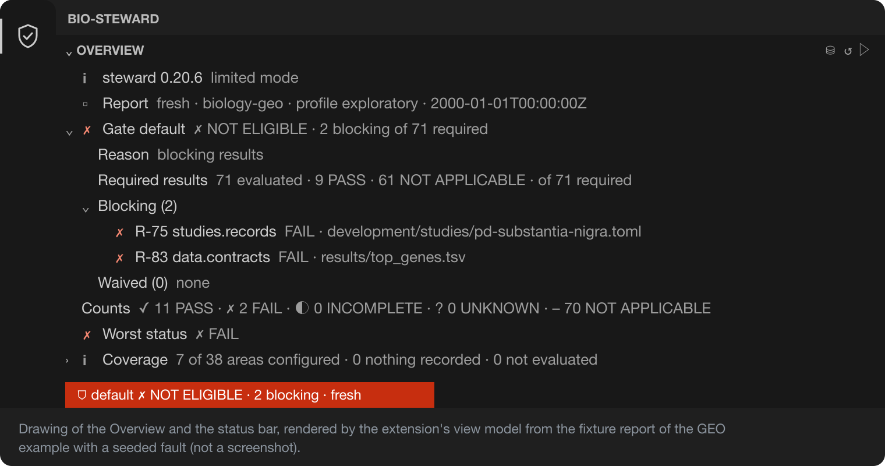
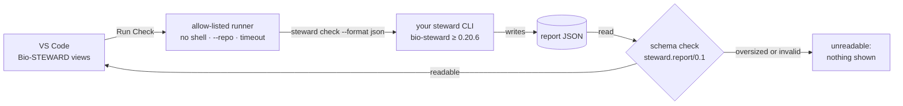
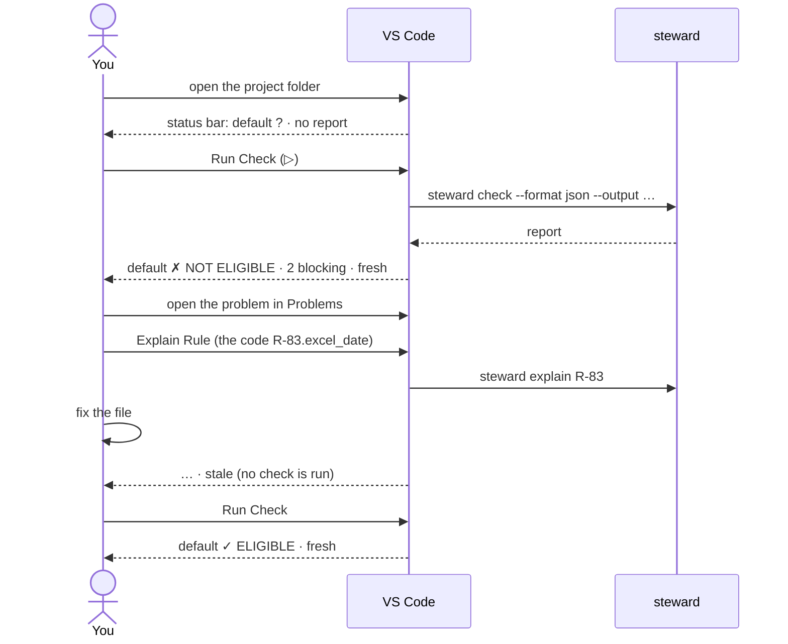
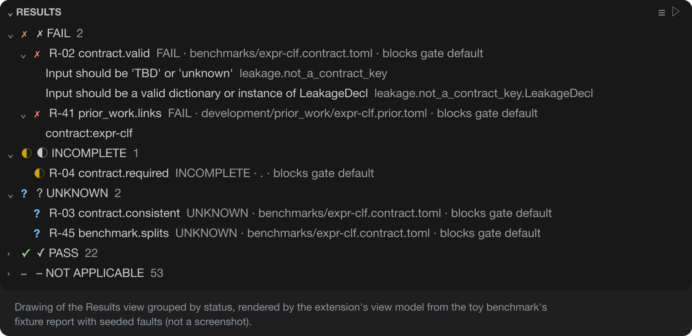
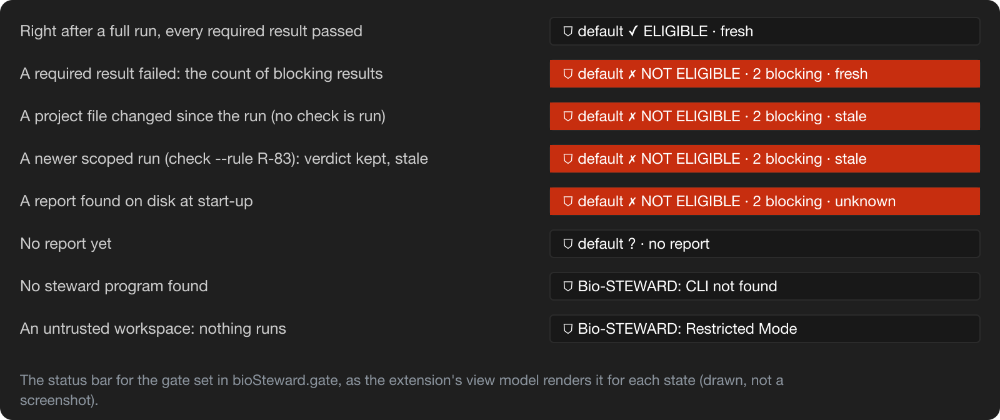
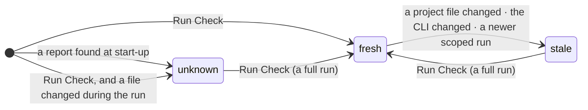
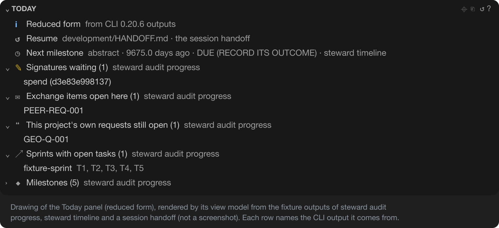
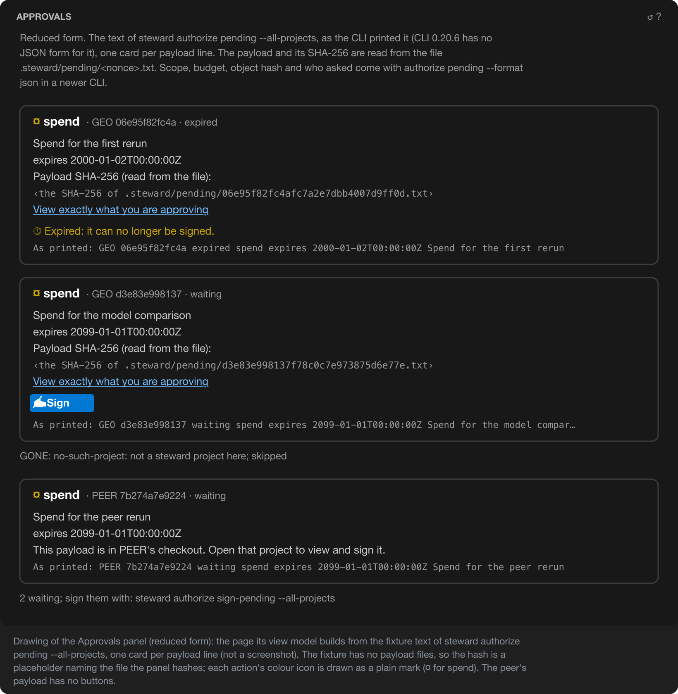
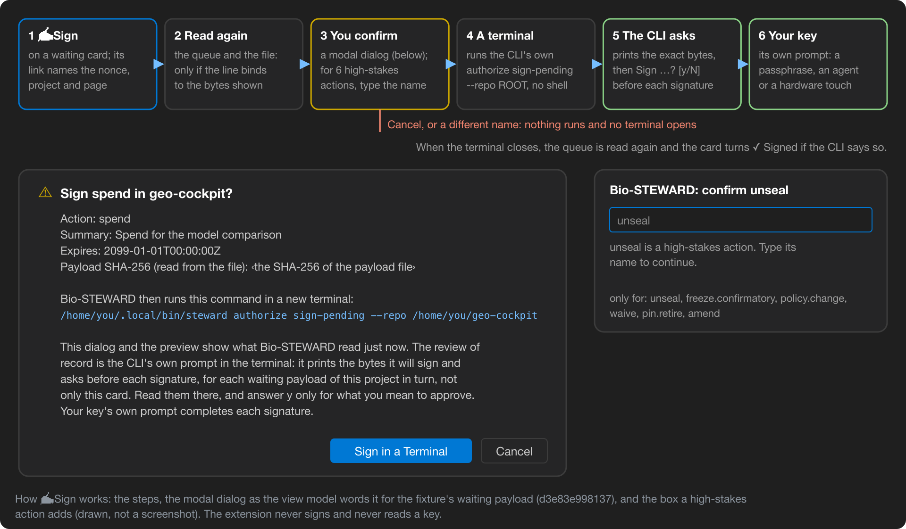
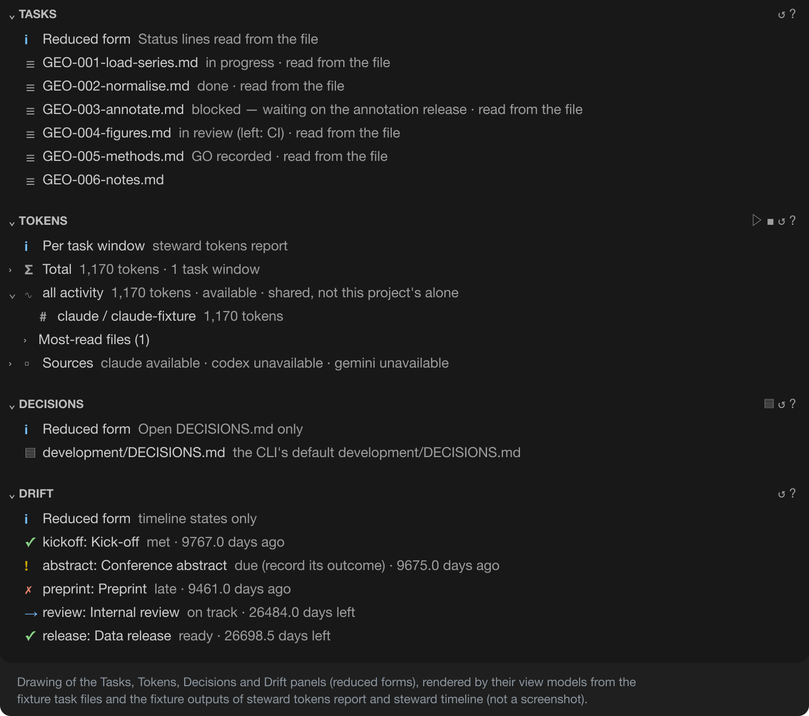

# Bio-STEWARD in VS Code

The Bio-STEWARD extension for VS Code shows what `steward check` says about your repository where you write the
code: the gate verdict in the status bar, every result in a tree, the files they name in **Problems**, and the rule
behind each one a click away. It uses the `steward` program you installed; it decides nothing itself.

!!! note "Pre-release"
    The extension is in pre-release builds (0.0.x), installed from a `.vsix` file. The first public release, 0.1.0,
    goes to the VS Code Marketplace and Open VSX after a pilot in real projects.

<p align="center"></p>

| | |
|---|---|
| 🧠 **No AI inside** | no model calls and no tokens; it works with any agent, or none |
| 📡 **No network, no telemetry** | the extension makes no network requests; reports stay on your machine |
| 🛡️ **The CLI decides** | every status, count and gate is read off the report |
| 🔒 **Restricted Mode runs nothing** | in an untrusted workspace no CLI command runs |
| ✍️ **It never signs for you** | no command signs, approves, publishes or spends by itself. **✍ Sign** in the Approvals panel asks you first, then starts the CLI's own signing in a terminal, where the CLI asks again and your key completes it |

## How it works



The extension runs a short, fixed list of `steward` commands, each built from typed arguments and started without a
shell. It reads the report, checks it against the report schema it carries, and draws the views from it. Every
number on screen is a number in the report.

## 1. Install

| Step | Do |
|---|---|
| 1. The CLI | `uv tool install "git+https://github.com/MuizZer07/Bio-STEWARD.git@v0.20.6"` (or `pipx install …` with the same address). The package is `bio-steward`; its `--version` must read 0.20.6 or newer |
| 2. The extension | in VS Code, **Extensions: Install from VSIX…** and pick `bio-steward-<version>.vsix` |
| 3. A project | open a folder with a `steward.toml`. Without one, the **Set up a Bio-STEWARD project** walkthrough runs `steward init` for you, after showing the CLI's dry run |
| 4. Trust | trust the workspace when VS Code asks. In Restricted Mode the extension runs nothing |

The extension finds `steward` on `PATH`, then in the pipx and uv tool folders. To use another program, set
`bioSteward.cliPath` in your **user** settings; a workspace cannot set it, and a repository's own `.venv` is never
picked.

| Works in | Does not work in |
|---|---|
| VS Code 1.100 or newer on macOS and Linux; Remote-SSH (cluster nodes), WSL, dev containers | vscode.dev and github.dev (no local processes); Windows without WSL |

## 2. Your first check, step by step



1. **Open the folder.** The extension activates when the workspace holds a `steward.toml`. The status bar shows the
   gate named in `bioSteward.gate` (`default` unless you change it).
2. **Run Check** (the ▷ button on the Overview or Results view, or the command palette). The CLI runs
   `steward check --format json --output .steward/report.json`, or writes to the extension's storage (see
   [Where the report goes](#where-the-report-goes)).
3. **Read the verdict.** The Overview lists each gate with its blocking and waived lists, the five counts, the worst
   status and the coverage statement.
4. **Go to the file.** A FAIL with a file appears in **Problems** at the reported line (or line 1). In the GEO
   example with a seeded fault, R-83 reports `'7-Sep' looks like a spreadsheet date` in `results/top_genes.tsv`.
5. **Explain the rule.** Select the problem's code, or **Explain Rule…** from a result's context menu. The text is
   `steward explain R-83`, shown as the CLI prints it.
6. **Fix and check again.** As soon as you save, the report reads *stale*; no check runs on its own unless you turn
   on `bioSteward.check.onSave` (then a check runs 2 s after the last save, one at a time per project, never for a
   save under `.steward/` or `.git/`). **Run Check** makes it *fresh* again.

## 3. What each view shows

<p align="center"></p>

| View | Shows | Read off |
|---|---|---|
| ⛉ Status bar | one gate: ELIGIBLE or NOT ELIGIBLE, the blocking count, freshness; the countdown to the next milestone | `gates[]`, `summary`; `steward timeline --json` |
| Overview | the CLI; the report (freshness, project, profile, time); gates with blocking and waived lists; counts; worst status; coverage | the report's `verdict` |
| Results | every result by status, gate or file, with its details and the gates it blocks | `results[]` |
| Problems | FAIL → error, INCOMPLETE → warning, UNKNOWN → information (or warning, by setting) | results that name a file |
| Explain | the CLI's text for a rule | `steward explain R-83` |
| Agent Skills | skill folders on disk, R-60's codes (linked, copy, drift…), install with a dry run first | R-60 and the folders |
| Sprint | a running sprint's tasks, states (derived ones labelled), times, done-commands with exit codes, the commit recorded when a task ends; commits during a task come later from the CLI | the sprint file and its ledger only (no git) |

Each panel has a **?** button that opens a plain-language explanation of it, bundled with the extension. The
cockpit panels (Today, Approvals, Tasks, Tokens, Decisions, Drift) have [their own section](#the-cockpit).

Statuses always carry a word: ✓ PASS · ✗ FAIL · ◐ INCOMPLETE · ? UNKNOWN · – NOT APPLICABLE. Colour is never the only
signal.

<p align="center"></p>

## 4. Fresh, stale, unknown



| Word | Means |
|---|---|
| **fresh** | the extension made this report and no project file changed since |
| **stale** | something changed since; run the check again |
| **unknown** | the extension cannot tell (a report it did not make, or a change during the run) |

File changes only ever downgrade. Changes under `.steward/` and git's own bookkeeping do not count; a moved branch
does. The word *current* is not used: CLI 0.20.6 cannot show that a report still matches the files.

**A newer CLI changes nothing yet.** The extension detects it and says "CLI newer than tested" in the log, but
Explain, Agent Skills, Initialize Project and freshness work as they do on 0.20.6. Their richer forms (structured
explanations, a skills inventory, an init file list, *current* shown by a digest) arrive in a later release, once
the CLI offers them (requests C1 – C8).

**A scoped run never changes a gate badge.** **Run Check for Area…** (`steward check data`) and **Run Check for
Rule…** (`steward check --rule R-83`) are partial runs: their gates read NOT EVALUATED BY THIS RUN, the full verdict
stays in the status bar marked *stale*, and their report never replaces the shared one.

## The cockpit

The check panels above answer "may this project move on?". The cockpit panels answer the questions of a working
day: *what waits, and for whom? what do I sign? which tasks are open, and what did they cost? which target needs
attention?* They arrive in the 0.0.5 pilot build, ahead of extension 0.2.0.

!!! note "Reduced forms"
    The full cockpit reads documents a newer CLI will print (a `next` command, the task board and the signing queue
    as JSON, drift in the timeline). Until that CLI is released, each panel shows only what CLI 0.20.6 already
    prints, says so on its first row ("Reduced form") and names its source on every row. Nothing is guessed to fill
    the gaps.

| Panel | Answers | Reads (CLI 0.20.6) | Not yet (needs a newer CLI) |
|---|---|---|---|
| **Today** | what waits, and for whom? | `steward audit progress --json`, `steward timeline --json`, the session handoff | one next action per row, "since then", needs tidying |
| **Where am I?** | where did I leave off? | the same, as one page | recent decisions and drift |
| **Approvals** | what waits for my signature? | `steward authorize pending --all-projects` (text) and the payload files | scope, budget and who asked; signing one card alone |
| **Tasks** | which tasks are open? | the task files' `Status:` lines, as written | each task's window, owner and "stale" marks |
| **Tokens** | what did each task cost? | `steward tokens report --json` | totals per sprint and per day |
| **Decisions** | where are the decisions written? | `steward.toml` names the log; the panel opens it | the decisions listed, open ones first |
| **Drift** | which target needs attention? | `steward timeline --json`: each milestone's state | dates that moved, work out of order |

With several projects open, every panel shows one block per project and never mixes their rows. Projects come in
the Today order: more signatures waiting first, then open exchange items, your own open requests, then sprints with
open tasks. That is a plain order of counts, not a judgement.

### Today and Where am I?

<p align="center"></p>

**Today** is the first panel of the Bio-STEWARD sidebar. From the top: **Resume** opens your last session handoff as
written; **Next milestone** is the status bar's countdown; then the lists of the "Pending" part of
`steward audit progress`, item by item: signatures waiting (only you can give those), exchange items open here, this project's own
requests still open, sprints with open tasks, and every milestone.

**Where am I?** is the same information as one page, for a project you come back to. It opens by itself once when
you reopen a project after more than 3 days (`bioSteward.whereAmI.showOnReopen`, `bioSteward.whereAmI.reopenAfterDays`),
or from the Today title bar. **Copy as Agent Brief** puts that page on the clipboard for a new agent session, with
the handoff cut to its first 40 lines. Making it runs only read commands.

### Approvals: what waits for your signature

<p align="center"></p>

An agent can prepare a request for your signature (`steward authorize prepare`) but never sign it. The Approvals
panel turns each line of `steward authorize pending --all-projects` into a **card**: the action and its icon, the
project, the payload's short ID and its state (*waiting*, *signed*, *expired*), the summary and expiry as the CLI
printed them, and the payload's SHA-256, worked out from the payload file `.steward/pending/<nonce>.txt`. The line
itself is shown underneath, exactly as printed.

- **View exactly what you are approving** opens that payload file read-only, unchanged. It is read inside the
  project only, never through a link, up to 1 MiB.
- **✍ Sign** appears on a waiting card of this project whose queue line matches its file. A peer project's card has
  no buttons: open that project to sign it.
- A card is **display only** (View, no ✍ Sign, and the reason) when its queue line cannot be tied to its file without
  doubt: a summary over several lines, another line with the same short ID (a peer's, for example), a line under
  another project's code, or a file that no longer gives the line the CLI printed.

### What ✍ Sign does, step by step

<p align="center"></p>

```mermaid
sequenceDiagram
  actor You
  participant P as Approvals panel
  participant CLI as steward (in a terminal)
  participant K as your key
  You->>P: ✍ Sign on a waiting card
  P->>P: read the file, steward authorize pending, the file again (same bytes? one line that matches them?)
  P-->>You: modal dialog: action, summary, expiry, SHA-256 (one read), the exact command
  You->>P: Sign in a Terminal (or Cancel: nothing runs)
  opt unseal, freeze.confirmatory, policy.change, waive, pin.retire, amend
    P-->>You: type the action's name
    You->>P: unseal (anything else: nothing runs)
  end
  P->>CLI: a new terminal runs steward authorize sign-pending --repo ROOT
  CLI-->>You: the exact bytes of each waiting payload, then "Sign …? [y/N]"
  You->>CLI: y (or n)
  CLI->>K: sign
  K-->>You: its own prompt: passphrase, agent confirmation or touch
  P->>P: terminal closed: read the queue again; the card turns ✓ Signed
```

1. **The card is checked again.** The button carries only the payload's nonce, the project's place in the window and
   the page it is on. Bio-STEWARD reads the payload file, the queue and the file again, and goes on only if the card
   is on the page now shown, the file still has the SHA-256 the card shows, and exactly one queue line, in this
   project, is the line the CLI prints for those bytes.
2. **A modal dialog asks you.** It shows the action, the summary, the expiry and the payload's SHA-256, all from that
   one read of the file, and the exact command it will run. It says plainly that the dialog is a snapshot and **the
   CLI's own prompt in the terminal is the review of record**. Only a person can answer it: **Sign in a Terminal** or
   **Cancel**. Cancel runs nothing and opens no terminal.
3. **For a high-stakes action you type its name.** For `unseal`, `freeze.confirmatory`, `policy.change`, `waive`,
   `pin.retire` and `amend`, a box asks you to type the action's name exactly. Any other text stops here.
4. **The CLI still shows the bytes and asks.** A new terminal runs the CLI's own
   `steward authorize sign-pending --repo ROOT`, with your environment as VS Code started; a workspace's
   `terminal.integrated.env.*` settings and other extensions' additions do not reach it. The CLI prints the exact bytes of each waiting payload of this project and asks *Sign …? [y/N]*
   before each signature. Answer no to anything you do not mean to approve; closing the terminal at that question
   signs nothing.
5. **Your key's prompt completes it.** The key's own confirmation (a passphrase, an SSH agent that asks, a hardware
   touch) completes each signature. When the terminal closes, the panel reads the queue again and the card turns
   **✓ Signed** if the CLI says so.

The extension never signs, never reads a key, and never adds the CLI's flag that skips its question. A command an
agent sends reaches the same dialog, which only a person can accept. In CLI 0.20.6, `sign-pending` asks about each
waiting payload of the project in turn; signing one card alone needs a newer CLI.

Which program signs is the CLI's business. CLI 0.20.7 signs with the pinned `ssh-keygen` whatever the repository's
git configuration says. With 0.20.6, `git tag -s` takes its signing program and key from your git configuration,
the repository's own `.git/config` included; use 0.20.7 or later for signing.

### Tasks, Tokens, Decisions and Drift

<p align="center"></p>

| Panel | In plain words |
|---|---|
| **Tasks** | every task file of the project (the `[tasks]` table of `steward.toml`, or `development/tasks/**/*.md`), with the line that holds its `**Status:**` label **exactly as written**, marked *read from the file*. Open tasks first; closed ones under **Closed**, a display grouping by the rule of the CLI's R-57. A file without a Status line shows nothing beside it. Files are found as the CLI lists them (no link, never `.git`); click to open the file, which is checked again first |
| **Tokens** | how many tokens your agents used per **task window** and per model, read by `steward tokens report --json` from the agents' own log files on this machine. Point it at those logs once in your user settings (`bioSteward.tokens.claudeLogs`, `…codexLogs`, `…geminiLogs`); a repository cannot set them. **Start Task Window…** and **Done Task Window…** run `steward task start ID` and `steward task done ID` after showing you the exact command. **Total** is the sum of the rows. The logs are shared by every open project and the CLI matches them by time, not by project, so the **all activity** row is marked *shared* |
| **Decisions** | where the owner's decisions are written: the log `steward.toml` names (`[integrity] decisions`), or the CLI's default `development/DECISIONS.md`. **Open DECISIONS.md** opens it as it is (the first log that exists; a row says when that is not the first one configured, which the CLI's single-path commands use). The extension never writes a decision; you do, in your own words |
| **Drift** | each milestone of `development/milestones.toml` with its state **in the CLI's own words** (*on track*, *at risk*, *late*, *due (record its outcome)*, *ready*, *met*, *moved*, *dropped*) and its days left or ago, in the CLI's order. Click a row to open the milestones file. Dates change only there, with a decision |

## 5. Working with agents

| You want | Use |
|---|---|
| your agent to see what failed | **Copy Summary for Agent**: the CLI's `steward check --summary` text, unchanged, with the command that re-checks it and the size in bytes. From a result: `steward check --rule R-83 --summary` |
| a new agent session to pick up where the last one stopped | **Copy as Agent Brief** (Today): the Where am I? page, with the handoff's first 40 lines |
| to know what a task cost | open a task window when an agent picks it up and close it when the task is done (Tokens) |
| you and your agents to read one verdict | `bioSteward.report.location = auto` (the default) writes `.steward/report.json` when git ignores it, as `steward init` sets up |
| the next sprint task started | the Sprint view's **Copy Order Command** puts `steward sprint go ID TASK` on the clipboard; you run it |

Nothing the extension copies is typed into a terminal for you.

## Where the report goes

| `bioSteward.report.location` | File |
|---|---|
| `auto` (default) | `.steward/report.json` when git ignores it; otherwise the extension's own storage |
| `repository` | `.steward/report.json` |
| `extension` | the extension's storage only; nothing is written to the repository |

`auto` asks git one read-only question, `git check-ignore`, with the repository's fsmonitor and hooks forced off and
only `PATH`, `HOME` and `GIT_CONFIG_NOSYSTEM=1` in its environment. It is the only git command the extension runs.

Each check writes its report to a new file of its own; only a check that ends with a verdict (exit 0 – 3) and a
valid report replaces the saved one, in one step. A cancelled or failed check leaves the saved report as it was.

## Safety and its limits

| The extension | How |
|---|---|
| runs only listed commands | typed builders, no shell, `--repo` set, a timeout, one run at a time, the whole process tree stopped on cancel |
| shows nothing it cannot read | a report that fails the schema, or is too large, shows as *unreadable*, never as a partial dashboard |
| keeps paths inside the project | a path in a report that leaves the project (or a link that does) is not opened |
| renders report text as text | reasons and messages are never rendered as HTML or markdown links |
| runs git once, confined | only `git check-ignore`; a repository's own filter, fsmonitor and hook programs never run (tested). The Sprint view runs no git |
| keeps webview links few | Explain, Init Preview and Skills Preview each enable one command link. Two of them, **Review command and confirm…** in the previews, lead to a write: a documented exception that only opens a confirmation showing the exact command. The Approvals panel enables two: **View exactly what you are approving** and **✍ Sign**. Every webview has no scripts |
| never signs | no command signs, approves, unseals, spends or publishes by itself. **✍ Sign** opens a modal dialog first; only after you accept does a terminal run `steward authorize sign-pending --repo ROOT`, which asks again, and your key completes it |

The extension cannot stop an agent that has a shell from running the CLI, or anything else, itself. A signing key
is protected by the key's own confirmation (a passphrase, an SSH agent that asks, a hardware touch) and by the
[constitution](https://github.com/MuizZer07/Bio-STEWARD/blob/main/CONSTITUTION.md), not by the extension.

## Troubleshooting

| The view says | Do |
|---|---|
| No steward CLI was found | install `bio-steward`, or set `bioSteward.cliPath` in your user settings; **Re-detect CLI** |
| The CLI found is older than this extension supports | upgrade `bio-steward` to 0.20.6 or newer |
| This workspace is not trusted | **Manage Workspace Trust**; in Restricted Mode nothing runs |
| This folder has no steward.toml | **Initialize** opens the setup walkthrough |
| The output of the last run was unreadable | **Show Log** for the CLI's error output; run the check in a terminal to compare |
| The CLI found no steward.toml it accepts here | fix `steward.toml`; `steward check` in a terminal names the problem |

The **Bio-STEWARD** output channel (**Show Log**) holds the CLI found, the check commands the extension ran with
their exit codes, and the CLI's error output.

## More

- The extension's [README](https://github.com/MuizZer07/Bio-STEWARD/blob/main/editors/vscode/README.md): every
  command and setting.
- Its [changelog](https://github.com/MuizZer07/Bio-STEWARD/blob/main/editors/vscode/CHANGELOG.md).
- Cite Bio-STEWARD: [doi:10.5281/zenodo.24548977](https://doi.org/10.5281/zenodo.24548977).
