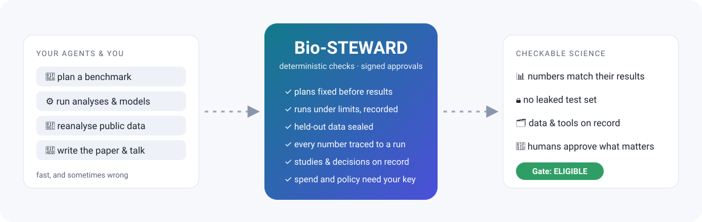

---
hide:
  - toc
---

{ width="420" }

# Bio-STEWARD



<p class="tagline"><b>Bio-STEWARD: Scientific Toolkit for Engineering, Workflow Assurance, Reproducibility, and
Development</b><br>The engineering and integrity layer for agentic computational biology. Your agents move fast. Your
science stays checkable.</p>

Cite it: [doi:10.5281/zenodo.24548977](https://doi.org/10.5281/zenodo.24548977) (every version; see
[CITATION.cff](https://github.com/MuizZer07/Bio-STEWARD/blob/main/CITATION.cff)).

Bio-STEWARD keeps a deterministic record of what was planned, run, frozen, found and claimed, and refuses what you
did not approve. It checks files, never the science: a PASS means your files agree with the rules you declared.

## Start here: ask your assistant
In a repository with Bio-STEWARD installed, say to your coding agent (Claude Code, Codex, Cursor or similar):

> Run the using-steward skill.

The agent runs `steward check`, reads the result and tells you what is ready and what is not. Everything in this guide
is something your agent can do for you; the commands are shown so you can check it.



## Install
```bash
pipx install "git+https://github.com/MuizZer07/Bio-STEWARD.git@v0.21.1"   # a development tool, pinned to a tag
steward init --skills .agents/skills                                       # configuration, templates and skills
steward check --summary
```
It is never a runtime dependency of your project.

## Who it is for

<div class="grid cards" markdown>

-   :material-dna:{ .lg .middle } **Computational biologists**

    ---

    Reanalyse public data with every accession, annotation release and tool version on record, and know which
    papers go stale when an input changes.

    [:octicons-arrow-right-24: Keep the research record](guides/research-records.md)

-   :material-chart-scatter-plot:{ .lg .middle } **ML-in-biology researchers**

    ---

    Benchmarks fixed before results, donor and study leakage checked, LLM test sets dated against each model's
    cutoff.

    [:octicons-arrow-right-24: Plan a benchmark](guides/benchmark.md)

-   :material-robot-outline:{ .lg .middle } **AI engineers building research agents**

    ---

    Runs under limits, signed approvals agents cannot forge, spend guards, sprints and briefs for dispatching work to
    other agents.

    [:octicons-arrow-right-24: Single-project governance](guides/single-project.md)

-   :material-account-group-outline:{ .lg .middle } **Lab leads and PIs**

    ---

    Decisions, reviews and dead ends on record; a Progress Audit and a timeline to the next deadline; one process
    across all the lab's projects.

    [:octicons-arrow-right-24: Multi-project governance](guides/multi-project.md)

</div>

## What it catches
| | Failure | Caught by |
|---|---|---|
| 🧪 | a split that leaks donors, patients or studies | benchmark contract, R-45, R-49 |
| 🔢 | a number in the abstract that no longer matches its result file | values registry, R-10, R-40 |
| 🧬 | a re-downloaded series that silently changed | study records, R-75 |
| 🤖 | LLM test cases public before the model's stated training cutoff | `[llm_eval]`, R-78 |
| 📚 | a citation that resolves to another paper | citation records, R-77 |
| 🔒 | a held-out set read early, a protocol changed after results | freeze and seal, R-35 – R-39 |
| 🧭 | decisions, reviews and dead ends lost in a chat | research records, R-76 |

## Where next
- [Recipes](recipes.md): the common jobs, step by step.
- [Quick start](quickstart.md), then the [worked example](worked-example.md).
- [Works with](works-with.md): skill libraries, workflow engines, data versioning.
- [What a PASS does not mean](concepts.md#what-a-pass-does-not-mean).
