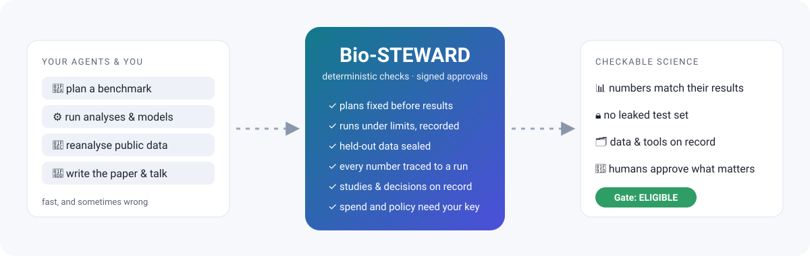

<p align="center"></p>

# Bio-STEWARD

**Scientific Toolkit for Engineering, Workflow Assurance, Reproducibility, and Development:** the engineering and
integrity layer for agentic computational biology. Your agents move fast; your science stays checkable.

[](https://doi.org/10.5281/zenodo.24548977)

`steward` is a small command-line tool with portable Agent Skills, a GitHub Action, pre-commit hooks and a Claude Code
plugin. It keeps a deterministic record of what was planned, run, frozen, found and claimed, and refuses the
controlled operations (runs, unsealing, spend, policy changes) that you did not approve.

<p align="center"></p>

## What it catches
| Failure | Caught by |
|---|---|
| A split that leaks donors, patients or studies | benchmark contracts (R-45, R-49) |
| A number in the abstract that no longer matches its result file | the paper's values registry (R-10, R-40) |
| A re-downloaded dataset that silently changed | study records (R-75) |
| LLM test cases public before the model's stated training cutoff | `[llm_eval]` (R-78) |
| A citation that resolves to another paper | citation records (R-77) |
| A held-out set read early, a protocol changed after results | freeze and seal with signed approvals (R-35 – R-39) |
| A paid API loop running overnight | the spend guard (R-34) |
| Reviews, decisions and dead ends lost in a chat | research records (R-76) |

## Quick start
```bash
pipx install bio-steward
cd your-research-repo
steward init --skills .agents/skills
steward check --summary
```
Then ask your coding agent: **"Run the using-steward skill."**

A PASS means your files agree with the rules you declared; it does not establish that a result holds. Bio-STEWARD is
a development tool, never a runtime dependency.

**Links:** [documentation](https://github.com/MuizZer07/Bio-STEWARD/blob/main/docs/index.md) ·
[changelog](https://github.com/MuizZer07/Bio-STEWARD/blob/main/CHANGELOG.md) ·
[source](https://github.com/MuizZer07/Bio-STEWARD) · MIT licence
