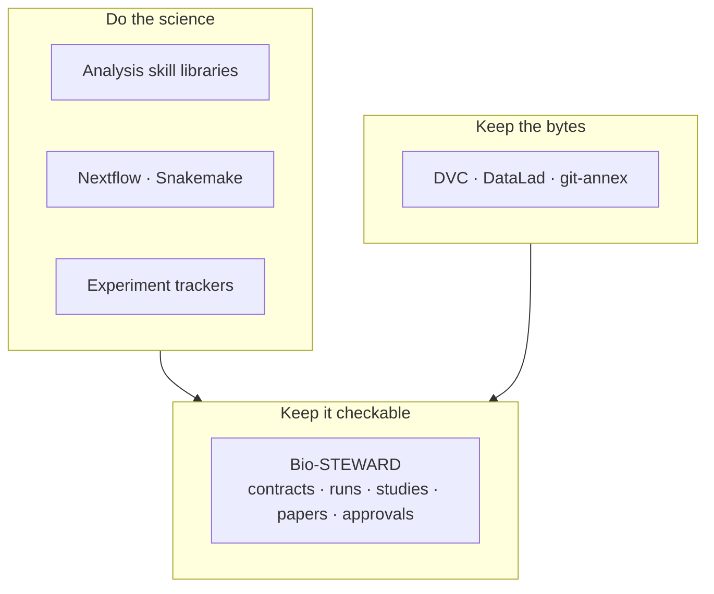

# Works with, does not replace

Bio-STEWARD is the **process layer**. Other tools do the analysis; Bio-STEWARD keeps what they did checkable.

| You use | For | With Bio-STEWARD |
|---|---|---|
| **Agent skill libraries for science** (collections of bioinformatics and scientific skills for Claude Code, Codex and other agents) | running the analyses | they do the work; `steward run` records it, study records keep its inputs and references, the paper kit ties its numbers to results |
| **Nextflow, Snakemake** | workflows | run a pipeline under `steward run`; record its outputs in a study record; `steward diff run` compares reruns |
| **DVC, DataLad, git-annex** | large data | `steward storage record` cross-checks their pointers; study records fingerprint the files a study uses |
| **Experiment trackers** | metrics and dashboards | keep using them; the benchmark contract fixes what is compared before the results exist |
| **LaTeX, Quarto, Pandoc** | papers and talks | PaperKit and PresentationKit check numbers, figures, venue rules and citations |
| **GitHub Actions, pre-commit** | CI | the [GitHub Action and hooks](guides/integrations.md) run the same gate |
| **MCP clients** | agents reading project state | `steward mcp` serves the read-only checks |

What Bio-STEWARD does not do: run analyses, fetch biomedical data, track experiments, orchestrate workflows or write
papers.
