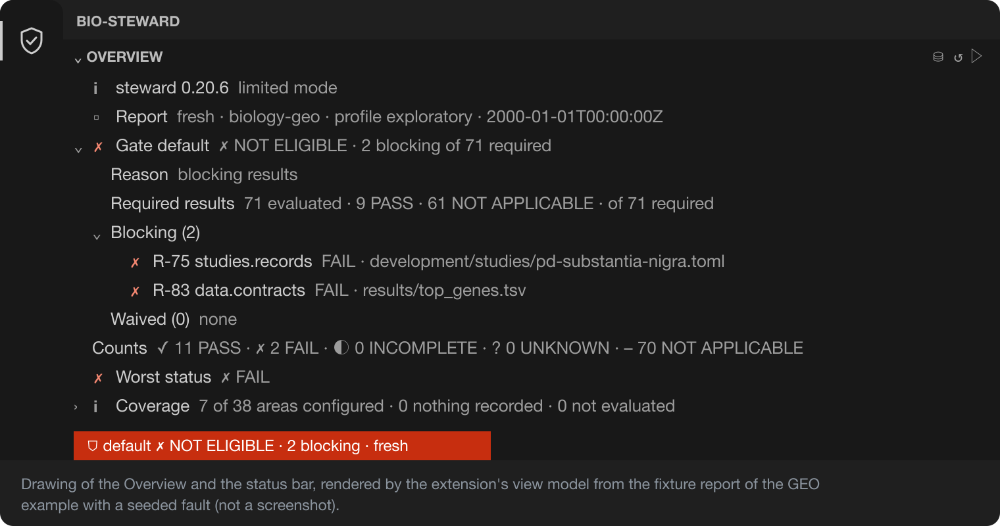
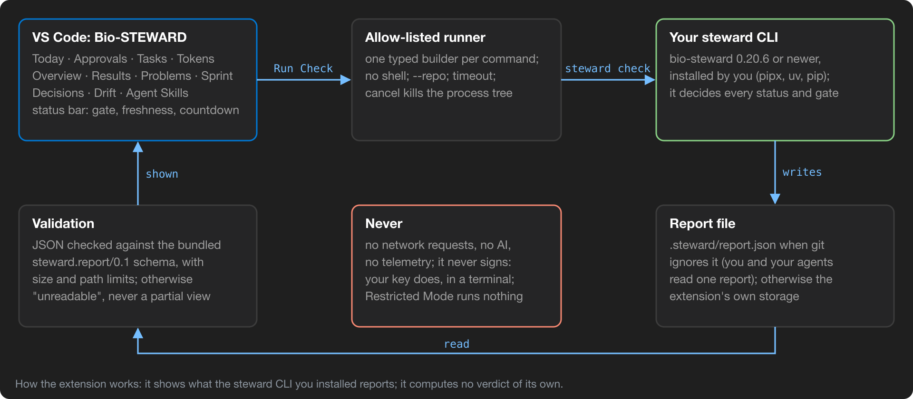
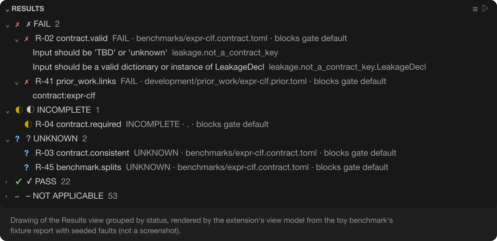
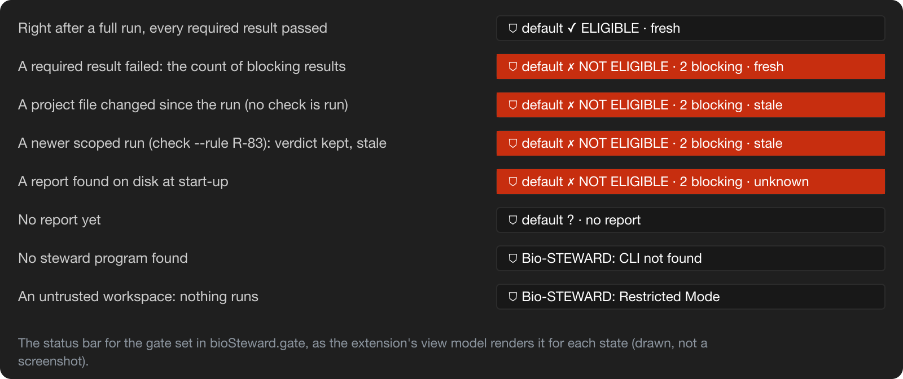
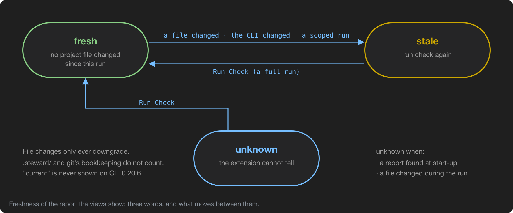
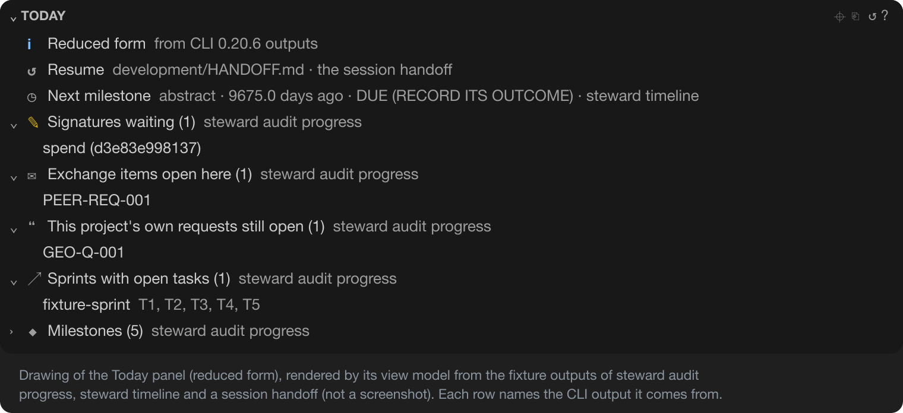
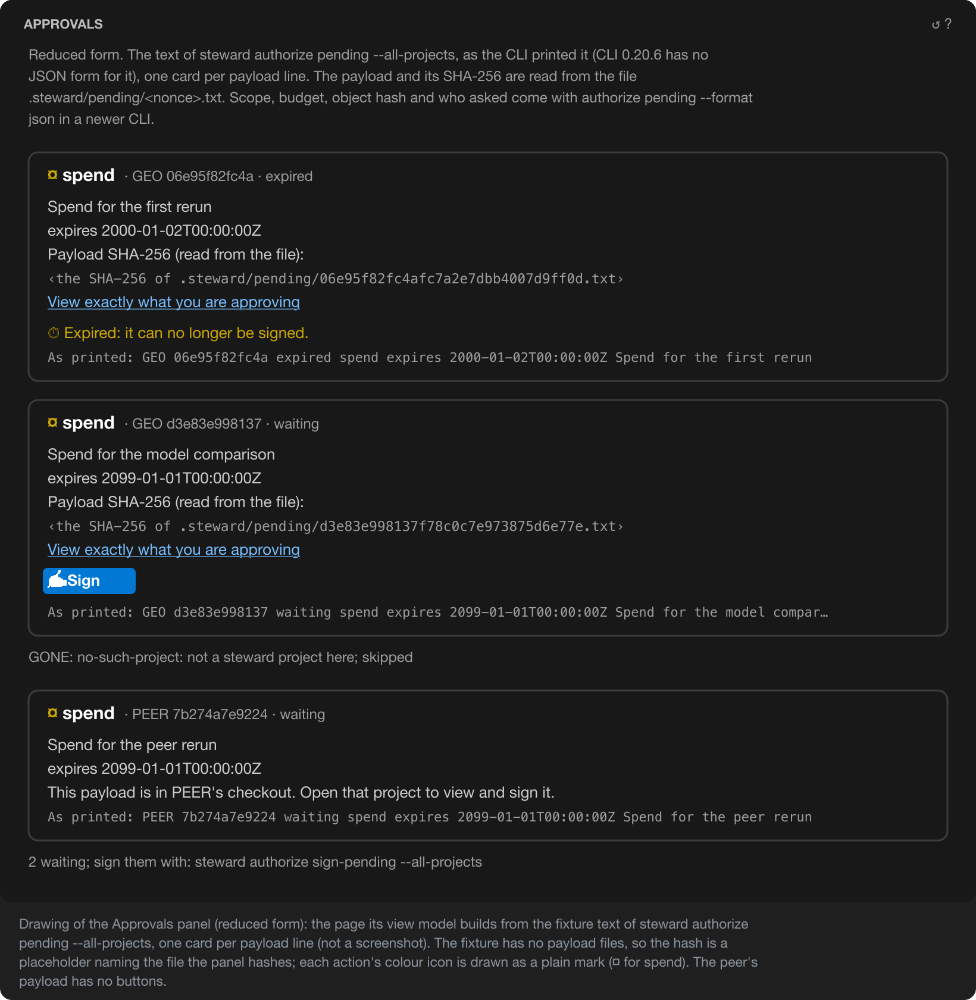
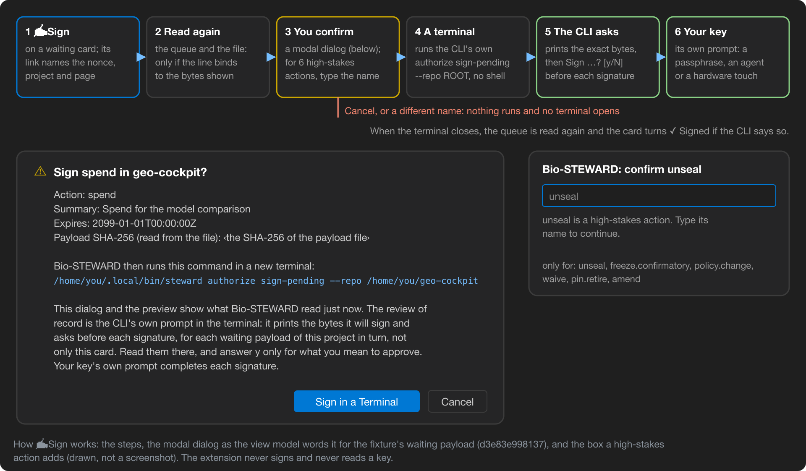
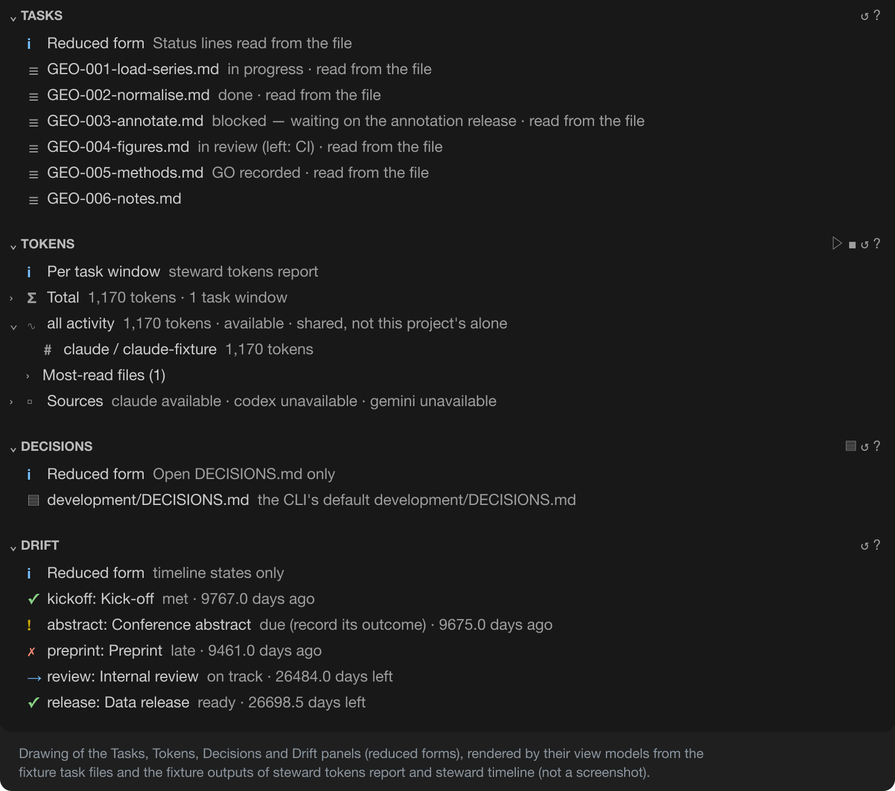

# Bio-STEWARD for VS Code

**Bio-STEWARD** (Scientific Toolkit for Engineering, Workflow Assurance, Reproducibility, and Development) checks a
computational-biology repository against its declared rules. This extension shows what `steward check` says about
your repository (the gate verdict, every result, the files they name and the rule behind each one) inside VS Code,
and, in its **cockpit** panels, what waits for you: signatures, open tasks, token costs, decisions and deadlines.

> **Pre-release build (0.0.x).** Not on the Marketplace yet: install the `.vsix` with **Extensions: Install from
> VSIX…**. The first public release is 0.1.0.

| | |
|---|---|
| 🧠 **No AI inside** | no model calls, no tokens; it works with any agent, or none |
| 📡 **No network, no telemetry** | the extension makes no network requests; reports stay on your machine |
| 🛡️ **The CLI decides** | every status, count and gate is read off the report; the extension computes no verdict |
| 🔒 **Restricted Mode runs nothing** | in an untrusted workspace no CLI command runs at all |
| ✍️ **It never signs for you** | no command signs, approves, publishes or spends by itself. The Approvals panel's **✍ Sign** asks you in a modal dialog first, then runs the CLI's own interactive signing in a terminal, where the CLI asks again and your key completes it |



## How it works



| Needs | |
|---|---|
| The CLI | the `bio-steward` package, **0.20.6 or newer** (tested with 0.20.6). The extension uses the `steward` program you installed and never installs, changes or replaces it |
| VS Code | 1.100 or newer: desktop, Remote-SSH, WSL and dev containers (the CLI runs where the files are). Not vscode.dev or github.dev. On Windows, use WSL |
| A project | a folder with a `steward.toml`; without one, the **Set up a Bio-STEWARD project** walkthrough runs `steward init` with a preview first |

Install the CLI (until it is on PyPI, from the release tag):

```bash
uv tool install "git+https://github.com/MuizZer07/Bio-STEWARD.git@v0.20.6"   # or pipx install "git+…@v0.20.6"
steward --version                                                          # steward 0.20.6
```

The extension looks for `steward` on `PATH`, then in the pipx and uv tool folders, or uses `bioSteward.cliPath` from
your **user** settings. A workspace cannot set that path, and a repository's own `.venv` is never picked.

## What you see

| Where | What |
|---|---|
| ⛉ **Status bar** | the gate you chose (`bioSteward.gate`): ELIGIBLE or NOT ELIGIBLE, the blocking count, and the report's freshness. Click for the Overview |
| **Overview** | the CLI; the report; every gate with its blocking and waived lists; the five counts; the worst status; the coverage statement |
| **Results** | every result, grouped by status, gate or file (**Group Results By…**), with its details and the gates it blocks |
| **Problems** | FAIL as errors, INCOMPLETE as warnings, UNKNOWN as information, at the file and line the CLI reports |
| **Explain Rule…** | the CLI's `steward explain R-xx` text, shown as it prints it |
| **Agent Skills** | the skill folders on disk, R-60's drift codes, and **Install Agent Skills…** with the CLI's dry-run plan first |
| **Sprint** | a running sprint's tasks, states, times against their limits, done-commands with exit codes, and the commit the ledger records when a task ends, read only from the sprint file and its ledger (no git). Commits and changed files *during* a task are not shown yet; they come later from the CLI |
| **Today**, **Approvals**, **Tasks**, **Tokens**, **Decisions**, **Drift** | the cockpit: see [below](#the-cockpit) |



Statuses are always a word with a glyph (✓ PASS · ✗ FAIL · ◐ INCOMPLETE · ? UNKNOWN · – NOT APPLICABLE), never colour
alone, and each tree row's accessible label carries the words.

### The status bar, state by state



**A scoped run never changes a gate badge.** **Run Check for Area…** and **Run Check for Rule…** produce a *partial
run*: its gates read NOT EVALUATED BY THIS RUN, and the status bar keeps the last full verdict, marked *stale*.

### Is the report still fresh?



The word **current** is never used: CLI 0.20.6 cannot show that a report still matches the files.

## The cockpit

Six panels for the working day, one block per open project, the most urgent first. Five of them are **reduced
forms**: CLI 0.20.6 does not yet print the documents their full forms read (a `next` command, the task board and the
signing queue as JSON, drift in the timeline), so each shows only what 0.20.6 prints, says "Reduced form" on its
first row and names its source on every row.

| Panel | Answers | Reads (CLI 0.20.6) |
|---|---|---|
| **Today** (reduced) | what waits, and for whom? Resume, the next milestone, signatures waiting, exchange items, your own open requests, sprints with open tasks | `steward audit progress --json`, `steward timeline --json`, the session handoff |
| **Where am I?** (reduced) | the same as one page, shown once when you reopen a project after 3 days; **Copy as Agent Brief** | the same |
| **Approvals** (reduced) | what waits for your signature: one card per payload, with **View exactly what you are approving** and **✍ Sign** | `steward authorize pending --all-projects` (text) and `.steward/pending/<nonce>.txt` |
| **Tasks** (reduced) | every task file, open first, with its `Status:` line exactly as written, *read from the file* | the task files |
| **Tokens** | tokens per task window and model; **Start / Done Task Window…** after confirmation | `steward tokens report --json` over the agent logs you select |
| **Decisions** (reduced) | **Open DECISIONS.md**: the log `steward.toml` names, opened as it is | `steward.toml` |
| **Drift** (reduced) | each milestone's state in the CLI's words (on track, at risk, late, …) | `steward timeline --json` |



### Approvals and ✍ Sign



**✍ Sign** never signs. In plain words:

1. Bio-STEWARD reads the payload file, the queue and the file again. It goes on only if the link is a card of the
   page now shown, the file still has the SHA-256 the card shows, and the queue holds exactly one line for it, in
   this project, that is the line the CLI prints for those bytes. Otherwise the card is **display only**: it says
   why and offers no ✍ Sign (a summary over several lines, a peer with the same nonce prefix, a changed file).
2. A **modal dialog** shows the action, summary, expiry and payload SHA-256, all from that one read of the file, and
   the exact command. It says plainly that **the CLI's own prompt in the terminal is the review of record**. Only a
   person can answer it (**Sign in a Terminal** or **Cancel**).
3. For `unseal`, `freeze.confirmatory`, `policy.change`, `waive`, `pin.retire` and `amend` you also **type the
   action's name**. Any other text stops here.
4. A new terminal runs the CLI's own `steward authorize sign-pending --repo ROOT`, with an environment Bio-STEWARD
   gives in full: yours, as VS Code started, without a workspace's `terminal.integrated.env.*` settings or any
   extension's additions. **The CLI still prints the exact bytes** of each waiting payload of the project, not only
   this card's, and asks *Sign …? [y/N]* before each signature. Read them there.
5. **Your key's own prompt** (a passphrase, an agent confirmation or a hardware touch) completes it. When the
   terminal closes, the card turns ✓ Signed if the CLI says so.

Which program signs is the CLI's business. CLI 0.20.7 signs with the pinned `ssh-keygen` (`gpg.format=ssh`, no
`gpg.ssh.defaultKeyCommand`) whatever the repository's git configuration says (STW-057). With 0.20.6, `git tag -s`
takes its signing program and key from your git configuration, the repository's own `.git/config` included, so a
repository can choose them; use 0.20.7 or later for signing.



### Tasks, Tokens, Decisions and Drift



### With a newer CLI

This version uses the command forms of CLI 0.20.6 for everything. It detects a newer CLI at start-up and names it in
the log ("CLI newer than tested"), but Explain, Agent Skills, Initialize Project and freshness work the same way.
Richer versions of them (structured explanations, a skills inventory, an init file list, *current* by digest) arrive
in a later release, once the CLI offers them (requests C1 – C8).

## Commands

| Command | What it runs |
|---|---|
| **Run Check** (▷) | `steward check --format json --output FILE` |
| **Run Check for Area…** / **for Rule…** | `steward check AREA …` / `steward check --rule R-xx …` (a partial run) |
| **Copy Summary for Agent** | puts `steward check --summary` on the clipboard, unchanged, with the re-check command and its size in bytes |
| **Explain Rule…** | `steward explain R-xx` |
| **Show Milestones** | `steward timeline --json`; the next one is the status-bar countdown `⌚ preprint · 12.3 days left` |
| **Resume: Show the Last Session Handoff** | opens the `[session] handoff` file read-only, its text unchanged |
| **Initialize Project…** | `steward init … --dry-run` first; runs `steward init …` after you confirm the exact command |
| **Install Agent Skills…** | `steward init --skills … --dry-run` first; runs it after you confirm |
| **Copy Order Command** (Sprint view) | puts `steward sprint go ID TASK` on the clipboard; it never starts a task |
| **Refresh Today** / **Where am I?** | `steward audit progress --json` and `steward timeline --json`; reads the handoff |
| **Copy as Agent Brief** | puts the Where am I? page on the clipboard (the handoff cut to 40 lines) |
| **Refresh Tasks** | reads the task files; runs nothing |
| **Refresh Tokens** | `steward tokens report --json --claude …` with the logs you selected |
| **Start Task Window…** / **Done Task Window…** | `steward task start ID` / `steward task done ID`, after you confirm the exact command |
| **Refresh Approvals** | `steward authorize pending --all-projects` |
| **View Exactly What You Are Approving** (card) | opens `.steward/pending/<nonce>.txt` read-only, unchanged |
| **✍ Sign…** (card) | a modal dialog, then `steward authorize sign-pending --repo ROOT` in a new terminal (see above) |
| **Open DECISIONS.md** | opens the decisions log in the editor; runs nothing |
| **Refresh Drift** | `steward timeline --json` |

Every command in the background runs through an allow-list of typed builders, without a shell, with `--repo` set to
the project, a timeout and a single run at a time. Three kinds of command write, each only after you confirm:

| Writes | How |
|---|---|
| **Initialize Project…**, **Install Agent Skills…** (project files) | allow-listed; the CLI's dry run and the exact command line first, then a modal |
| **Start / Done Task Window…** (a line in `.steward/task-tokens.jsonl`) | allow-listed; a modal with the exact command line |
| **✍ Sign** (a signed git tag) | **not** on the allow-list and never run in the background: a modal (and the typed name for high-stakes actions), then the CLI's own interactive signing in a visible terminal, where the CLI asks again and your key completes it |

With `bioSteward.check.onSave` on, saving a file runs **Run Check** for its project 2 s after the last save. Saves
during a run ask for one more run after it, never a second run at once; a save under `.steward/` or `.git/` never
runs a check; in Restricted Mode nothing runs.

Each check writes its report to a new file of its own. Only a check that exits 0 – 3 with a valid report replaces the
saved report, in one step (a rename), and only a newer check's report is ever shown over an older one. A cancelled
or failed check leaves the saved report as it was.

## Where the report goes

| `bioSteward.report.location` | Report file |
|---|---|
| `auto` (default) | `.steward/report.json` when git ignores it (as `steward init` sets up), so you and your agents read one report; otherwise the extension's own storage |
| `repository` | always `.steward/report.json` |
| `extension` | always the extension's storage; nothing is written to the repository |

`auto` asks git one read-only question (`git check-ignore`) with the repository's fsmonitor and hooks forced off. It
is the only git command the extension runs (see [Security](#security)). A scoped run's report always goes to the
extension's storage, never to the shared file.

## Settings

| Setting | Default | Set by | Purpose |
|---|---|---|---|
| `bioSteward.cliPath` | "" | you only | the `steward` program to use |
| `bioSteward.gate` | `default` | any level | the gate the status bar shows |
| `bioSteward.check.onSave` | `false` | any level | run the check 2 s after a save, one run at a time per project; never for `.steward/` or `.git/` |
| `bioSteward.report.location` | `auto` | any level | `auto`, `repository` or `extension` |
| `bioSteward.diagnostics.unknownSeverity` | `information` | any level | Problems severity for UNKNOWN |
| `bioSteward.timeoutSeconds` | `120` | you only | stop a CLI run after this long |
| `bioSteward.registry` | `respect` | you only | `disable` runs the CLI with `STEWARD_NO_REGISTRY=1` |
| `bioSteward.whereAmI.showOnReopen` | `true` | any level | show Where am I? once when a project is reopened |
| `bioSteward.whereAmI.reopenAfterDays` | `3` | any level | how many days away count as "reopened" |
| `bioSteward.tokens.claudeLogs` / `codexLogs` / `geminiLogs` | none | you only | the agents' log files or folders `steward tokens report` reads. Each file must still be inside the file or folder you named, reached without a link, when the CLI starts. The panel shows the CLI's counts, model names and the relative paths of files the agents read; when a log path cannot be used, the setup row names it |

In an untrusted workspace VS Code ignores the workspace's values of the "any level" settings.

## Security

| Concern | What the extension does |
|---|---|
| Untrusted workspaces | Restricted Mode: no CLI command and no git command runs, and no sprint, task, decisions or payload file is read |
| Running programs | only the `steward` you installed and `git` from `PATH`, never one inside a workspace folder; no shell; every argument from a typed builder on an allow-list. The one command outside the allow-list is the signing line below, and it runs only in a visible terminal, with an environment the extension sets in full (`strictEnv`) |
| git | one command only, `git check-ignore -q -- .steward/report.json`, with fsmonitor, hooks and the untracked cache forced off and a cleaned environment: `PATH`, `HOME` and `GIT_CONFIG_NOSYSTEM=1`, every other variable (all `GIT_*` among them) dropped. A test shows that a repository's own `filter.*.clean` and `filter.*.process` programs never run during it. The Sprint view runs no git at all, because `git status` can start such a filter program |
| Reading project files | sprint files and ledgers are opened without following links and without blocking, read up to a size limit, and must be valid UTF-8; nesting, task count, dependencies and ledger entries are bounded per refresh. Task files and decisions logs are found as the CLI lists project files (no link on the way, never in `.git`), and a row checks its file again when you click it. A payload file is read only if, after the read, `.steward`, `.steward/pending` and the file are still the same entries, none of them a link |
| Shared token logs | the agent logs are this machine's, the same for every open project, and the CLI matches records to a task window by time, agent, model and session, not by project. The Tokens panel labels the CLI's "all activity" row as shared |
| Webviews | four: Explain, Init Preview, Skills Preview and the Approvals panel. Each has `default-src 'none'`, no scripts and no local resources, and escapes all CLI and repository text. Explain and the previews each enable exactly **one** command link; Explain's copies `steward explain R-xx`. The Approvals panel enables **two**: **View exactly what you are approving** and **✍ Sign** |
| The one exception | Init Preview's **Review command and confirm…** (`bioSteward.applyInit`) and Skills Preview's (`bioSteward.applySkillsInstall`) are command links that lead to a write. That is a narrow, recorded exception to the design's rule that webview links are read-only (owner decision, 2026-11-26). Each link only opens a modal dialog with the exact command line; nothing runs until you confirm, and the plan is made again after you confirm, so what runs is what you saw |
| Signing (Approvals) | each card link carries only the full nonce, the project index and the generation of the page it is on; a link of an earlier page, or one that names no card of the page now shown, does nothing. The handler reads the payload file, runs `steward authorize pending` again (a read that is superseded or fails refuses) and reads the file once more; both reads must have the SHA-256 the card shows, and ✍ Sign also needs exactly one queue line for that nonce prefix, under this project's own code, equal to the line the CLI prints for those bytes. **View exactly what you are approving** reads `.steward/pending/<nonce>.txt` inside the project, never through a link, up to 1 MiB, and shows it unchanged in a read-only document named by the project's canonical folder, the full nonce and the SHA-256. **✍ Sign** shows a modal dialog (action, summary, expiry, payload SHA-256, all from that one read); for unseal, freeze.confirmatory, policy.change, waive, pin.retire and amend you also type the action's name. Only then, in the same call, a new terminal runs `steward authorize sign-pending --repo ROOT` as its own process (no shell, nothing typed into it, its environment set in full by the extension). The dialog is a snapshot: the CLI's own prompt is the review of record. It prints the bytes and asks before each signature, and the key's own prompt completes it. The extension never adds the CLI's flag that skips that question and never reads a key. A command an agent sends reaches the same dialog, which only a person can accept |

## What it does not do

- It does not decide anything: statuses, eligibility and reasons are the CLI's.
- It does not enforce anything outside Bio-STEWARD's interfaces. An agent with a shell can run the CLI, or anything
  else, without the extension; protecting a signing key is the key's job (a passphrase, agent confirmation or a
  hardware touch), not the extension's.
- It does not assess scientific validity. The coverage statement in every report says what was checked.

## More

- The guide: [Bio-STEWARD in VS Code](../../docs/guides/vscode.md)
- Changes: [CHANGELOG.md](CHANGELOG.md)
- Cite Bio-STEWARD: [doi:10.5281/zenodo.24548977](https://doi.org/10.5281/zenodo.24548977)

## Development

Node 22 or newer; everything runs from this folder.

| Command | What it does |
|---|---|
| `npm ci --ignore-scripts` | install the exact toolchain from the lockfile, install scripts disabled |
| `npm run check` | lint, type check and bundle, unit tests |
| `npm run test:host` | the tests inside a VS Code test host (VS Code is downloaded once into a shared folder; `BIOSTEWARD_VSCODE_TEST_CACHE` chooses it) |
| `npm run cli:install` | put the pinned CLI in `.cli/`; then `npm run check` also runs the unit suite against it |
| `npm run fixtures` | regenerate `test/fixtures/` from the pinned CLI; `-- --verify` fails if the committed files differ |
| `npm run figures` | redraw this README's figures from the view model and the fixture reports (`rsvg-convert` makes the PNGs); `-- --verify` checks the SVGs, and the unit suite runs that check |
| `npm run package` | build `bio-steward-<version>.vsix` (never publishes): the same commit gives the same bytes; `-- --twice` builds twice and compares |

The extension lives apart from the CLI: nothing here imports or runs the repository's `src/`.

## Licence

MIT. Bundled third-party code: [THIRD_PARTY_NOTICES.md](THIRD_PARTY_NOTICES.md).
